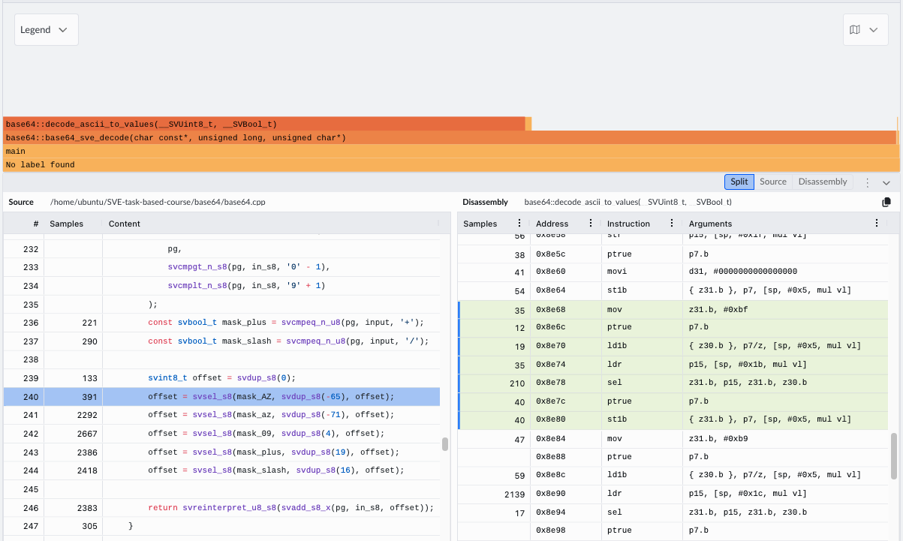

<!--
  SPDX-FileCopyrightText: Copyright 2026 Arm Limited and/or its affiliates <open-source-office@arm.com>
  SPDX-License-Identifier: BSD-3-Clause-Clear
-->

# Base64 Encode And Decode

This task implements Base64 encode and decode in scalar C++ and with SVE
intrinsics. It is a useful vectorization example because the arithmetic is
simple, but the data layout is awkward: encode transforms every 3 input bytes
into 4 printable ASCII bytes, while decode transforms every 4 Base64 characters
back into 3 bytes.

## What Base64 Does

Base64 represents binary data using 64 printable symbols:

```txt
A-Z a-z 0-9 + /
```

Each symbol carries 6 bits of information. Encoding therefore repacks 3 bytes
of input, or 24 bits, into 4 Base64 symbols:

```txt
aaa      -> YWFh
3 bytes  -> 4 bytes
24 bits  -> 4 * 6 bits
```

If the input length is not a multiple of 3 bytes, the output is padded with
`=` so the encoded stream still has a multiple of 4 characters. For example,
13 input bytes produce 20 Base64 characters.

## Why Base64 Is Useful

Base64 is useful when binary data has to travel through a channel that expects
printable text. Classic examples include sending attachments through email,
embedding small binary blobs in JSON or XML, or carrying bytes through logging,
configuration, and protocol fields that are easiest to handle as text streams.
The encoded output is larger, but it is made from ordinary printable characters
that are less likely to be corrupted by text-oriented infrastructure.

A practical wrinkle is that 6-bit data is not a conventional storage format for
software. Most machines address memory in bytes, and C/C++ programs naturally
store data in `uint8_t`, `char`, or wider integer types. Base64 therefore treats
6-bit values as indices, not as a native in-memory element type. The printable
encoded stream is stored as bytes or chars, even though each symbol represents
only 6 bits of payload.

The scalar implementation handles this by packing 3 input bytes into a
`uint32_t`, using bit operations to extract four 6-bit fields. Only 24 of the
32 bits are meaningful, so the upper 8 bits can stay unused. This is different
from the `=` characters used for Base64 stream padding: it is just temporary
padding inside the working integer. The 8-bit input bytes fit neatly into the
32-bit temporary; the 6-bit Base64 fields are recovered with shifts and masks.

In scalar form, the core encode step is:

```cpp
uint32_t val = ((uint32_t)input[i] << 16) |
               ((uint32_t)input[i + 1] << 8) | (uint32_t)input[i + 2];

output[j++] = encode_table[(val >> 18) & 0x3F];
output[j++] = encode_table[(val >> 12) & 0x3F];
output[j++] = encode_table[(val >> 6) & 0x3F];
output[j++] = encode_table[val & 0x3F];
```

The scalar decode path reverses the same idea: map each ASCII character back to
a 6-bit value, pack 4 values into 24 bits, and write 3 output bytes.

## Configure And Build

Build the base64 executable, tests, and benchmark binary in the optimized
Release configuration:

```bash
cmake --build build --config Release --target base64
cmake --build build --config Release --target test-base64
cmake --build build --config Release --target benchmark-base64
```

Use `--config Release` for benchmarking so the optimized configuration is
selected. With the multi-config generator, the Release binaries are placed under
configuration-specific directories such as `build/benchmark/Release/`.

## Running The Main Executable

The `base64` target builds a small command-line executable for trying the scalar
or SVE implementation outside the test and benchmark harnesses:

```bash
cmake --build build --config Release --target base64
```

Run it with the implementation mode and the number of repetitions:

```bash
./build/base64/Release/base64 scalar 1000
./build/base64/Release/base64 sve 1000
```

The executable builds an input buffer by repeating the string `sveisamazing`
`N` times, then encodes and decodes that buffer once. It is intentionally simple
and is mainly useful as a quick functional driver:

```txt
Usage = ./build/base64/Release/base64 <scalar|sve> <repetitions>
```

## Testing

Run only the base64 tests with:

```bash
cmake --build build --config Release --target test-base64
```

The tests cover:
- Scalar encode and decode for a clean 3-byte input.
- Scalar encode and decode for an input that needs `=` padding.
- SVE encode and decode variants for both examples.
- SVE decode across all Base64 alphabet classes.
- SVE encode/decode agreement with scalar across many input sizes, including
  small tails and larger benchmark-like buffers.

Full output from the test target:

```output
[1/1] cd /home/ubuntu/SVE-task-based-course/build/test && /home/ubuntu/SVE-task-based-course/build/test/Release/test --gtest_color=yes --gtest_filter="base64*"
Note: Google Test filter = base64*
[==========] Running 6 tests from 1 test suite.
[----------] Global test environment set-up.
[----------] 6 tests from base64Test
[ RUN      ] base64Test.scalarFunctionalTest
[       OK ] base64Test.scalarFunctionalTest (0 ms)
[ RUN      ] base64Test.scalarSentenceFunctionalTest
[       OK ] base64Test.scalarSentenceFunctionalTest (0 ms)
[ RUN      ] base64Test.sveEncodeVariantsFunctionalTest
[       OK ] base64Test.sveEncodeVariantsFunctionalTest (0 ms)
[ RUN      ] base64Test.sveDecodeVariantsFunctionalTest
[       OK ] base64Test.sveDecodeVariantsFunctionalTest (0 ms)
[ RUN      ] base64Test.sveDecodeVariantsMatchScalarForAlphabetClasses
[       OK ] base64Test.sveDecodeVariantsMatchScalarForAlphabetClasses (0 ms)
[ RUN      ] base64Test.sveVariantsMatchScalarAcrossSizes
[       OK ] base64Test.sveVariantsMatchScalarAcrossSizes (0 ms)
[----------] 6 tests from base64Test (0 ms total)

[----------] Global test environment tear-down
[==========] 6 tests from 1 test suite ran. (0 ms total)
[  PASSED  ] 6 tests.
```

## Implementation

### Scalar Encode

The scalar encoder walks the input in complete 3-byte groups. Each group is
packed into a 24-bit value, split into four 6-bit indices, and translated with
the 64-symbol `encode_table`.

The output alphabet is stored as ordinary bytes because C++ does not have a
native 6-bit element type:

```cpp
constexpr array<char, 65> encode_table = {
    "ABCDEFGHIJKLMNOPQRSTUVWXYZabcdefghijklmnopqrstuvwxyz0123456789+/"};
```

The main loop consumes 3 input bytes at a time:

```cpp
size_t i = 0, j = 0;

for (; i + 2 < len; i += 3) {
    uint32_t val = ((uint32_t)input[i] << 16) |
                   ((uint32_t)input[i + 1] << 8) | (uint32_t)input[i + 2];

    output[j++] = encode_table[(val >> 18) & 0x3F];
    output[j++] = encode_table[(val >> 12) & 0x3F];
    output[j++] = encode_table[(val >> 6) & 0x3F];
    output[j++] = encode_table[val & 0x3F];
}
```

The mask `0x3F` is binary `00111111`, so each lookup index keeps exactly one
6-bit Base64 field. The shifts select the four fields from high to low:

```txt
bits 23..18 -> output[0]
bits 17..12 -> output[1]
bits 11.. 6 -> output[2]
bits  5.. 0 -> output[3]
```

The tail path handles 1 or 2 remaining input bytes and emits `=` padding where
the input did not provide enough bits for a real Base64 symbol:

```cpp
if (i < len) {
    uint32_t val = (uint32_t)input[i] << 16;
    if (i + 1 < len)
        val |= (uint32_t)input[i + 1] << 8;

    output[j++] = encode_table[(val >> 18) & 0x3F];
    output[j++] = encode_table[(val >> 12) & 0x3F];
    output[j++] = (i + 1 < len) ? encode_table[(val >> 6) & 0x3F] : '=';
    output[j++] = '=';
}
```

Key steps:

1. Pack 3 input bytes into a 24-bit value held in a `uint32_t`.
2. Extract four 6-bit fields with shifts and `0x3F` masks.
3. Translate each 6-bit index to printable ASCII.
4. Finish the final 1 or 2 input bytes with `=` padding.

The scalar path is compact and makes a good correctness reference, but it does
one small table lookup for each output byte.

### Scalar Decode

The scalar decoder first strips trailing `=` padding, then processes complete
4-character groups. It uses a 256-entry `decode_table` so any input byte can be
mapped directly to its Base64 value. Valid Base64 characters map to `0..63`;
other bytes map to the sentinel value `0xFF`.

Key steps:

1. Convert 4 ASCII characters to four 6-bit values.
2. Repack those 6-bit values into a 24-bit integer.
3. Store three decoded bytes.
4. Finish any short padded group with scalar tail logic.

### SVE Encode

The SVE encoder is vector-length agnostic. It asks the hardware for the number
of byte lanes with `svcntb()`, then chooses how many complete Base64 groups fit
in one vector:

```cpp
const size_t vl = svcntb();
const size_t groups = vl / 4;
const size_t in_chunk = groups * 3;
const size_t out_chunk = groups * 4;
```

For each vector chunk, `encode_indices` rearranges bytes with `svtbl_u8` so
each output lane can see the input bytes for its 3-byte group:

```cpp
const svuint8_t b0 = svtbl_u8(input, idx0);
const svuint8_t b1 = svtbl_u8(input, idx1);
const svuint8_t b2 = svtbl_u8(input, idx2);
```

It then applies the same bit manipulation as scalar code, but across byte lanes:

```cpp
out0 = b0 >> 2;
out1 = ((b0 & 0x03) << 4) | (b1 >> 4);
out2 = ((b1 & 0x0F) << 2) | (b2 >> 6);
out3 = b2 & 0x3F;
```

The optimized SVE encode path maps those 6-bit indices to ASCII with a small
shift table. Most Base64 ranges are contiguous in ASCII, so the implementation
does not need a full 64-byte lookup table for the final translation:

```cpp
return svreinterpret_u8_s8(
    svadd_s8_x(pg, svreinterpret_s8_u8(indices), shifts));
```

The vector loop is unrolled four ways to reduce branch overhead:

```txt
i += 4 * in_chunk
j += 4 * out_chunk
```

The remaining bytes, including any padding case, are handled by the scalar
encoder.

### Naive SVE Encode And `svtbl`

A direct scalar-to-vector port might try to perform one lookup in a 64-byte
ASCII table for every 6-bit output index. SVE's `svtbl_u8` is a register-table
lookup, so a single table covers 16 byte entries, not all 64 Base64 symbols.

The provided naive SVE encode variant shows a straightforward way to use
`svtbl` anyway: split the Base64 alphabet into four 16-byte chunks and select
the right chunk based on the 6-bit index:

```cpp
svuint8_t out = svtbl_u8(lut0, indices);
out = svsel_u8(svcmpge_n_u8(pg, indices, 16),
               svtbl_u8(lut1, svsub_n_u8_x(pg, indices, 16)),
               out);
out = svsel_u8(svcmpge_n_u8(pg, indices, 32),
               svtbl_u8(lut2, svsub_n_u8_x(pg, indices, 32)),
               out);
out = svsel_u8(svcmpge_n_u8(pg, indices, 48),
               svtbl_u8(lut3, svsub_n_u8_x(pg, indices, 48)),
               out);
```

This is already much better than falling back to scalar table lookups per lane,
and it is easy to understand. The optimized encode path goes one step further:
it uses `svtbl` only for a small shift lookup, then adds that shift to the
original Base64 index.

### SVE Decode

Decode has two separate problems:
- Map ASCII characters back to 6-bit Base64 values.
- Repack every 4 input lanes into 3 output lanes.

The benchmark initially showed that the SVE decode path needed attention. In
the captured decode flame graph, `decode_ascii_to_values` accounts for roughly
60% of the samples. That makes ASCII-to-value conversion the first function to
optimize: improving the final 4-to-3 byte repack is useful, but the profile says
classification dominates the current cost.



The vector decode loop is structured like this:

```cpp
const svuint8_t in =
    svld1_u8(pg_in, reinterpret_cast<const uint8_t *>(input + i));
const svuint8_t values = decode_ascii_to_values<variant>(in, pg_all);

const svuint8_t lhs = svtbl_u8(values, lhs_idx_vec);
const svuint8_t rhs = svtbl_u8(values, rhs_idx_vec);

const svuint8_t out =
    svorr_u8_x(pg_all, svlsl_u8_x(pg_all, lhs, lhs_shift_vec),
               svlsr_u8_x(pg_all, rhs, rhs_shift_vec));

svst1_u8(pg_out, output + j, out);
```

So each vector chunk does four logical operations:

1. Load Base64 ASCII bytes.
2. Convert ASCII bytes to 6-bit values.
3. Use `svtbl_u8` to line up neighboring 6-bit values for each output byte.
4. Shift, OR, and store the decoded bytes.

#### Naive SVE Decode

The naive SVE decode variant translates ASCII to 6-bit values by testing every
lane against the Base64 alphabet ranges:

```cpp
const svint8_t in_s8 = svreinterpret_s8_u8(input);

const svbool_t mask_AZ = svand_b_z(
    pg,
    svcmpgt_n_s8(pg, in_s8, 'A' - 1),
    svcmplt_n_s8(pg, in_s8, 'Z' + 1));
const svbool_t mask_az = svand_b_z(
    pg,
    svcmpgt_n_s8(pg, in_s8, 'a' - 1),
    svcmplt_n_s8(pg, in_s8, 'z' + 1));
const svbool_t mask_09 = svand_b_z(
    pg,
    svcmpgt_n_s8(pg, in_s8, '0' - 1),
    svcmplt_n_s8(pg, in_s8, '9' + 1));
const svbool_t mask_plus = svcmpeq_n_u8(pg, input, '+');
const svbool_t mask_slash = svcmpeq_n_u8(pg, input, '/');
```

Those masks describe the five Base64 character classes:

```txt
'A'..'Z' ->  0..25  by adding -65
'a'..'z' -> 26..51  by adding -71
'0'..'9' -> 52..61  by adding   4
'+'      -> 62      by adding  19
'/'      -> 63      by adding  16
```

The code then selects the right per-lane offset and adds it to the ASCII byte:

```cpp
svint8_t offset = svdup_s8(0);
offset = svsel_s8(mask_AZ, svdup_s8(-65), offset);
offset = svsel_s8(mask_az, svdup_s8(-71), offset);
offset = svsel_s8(mask_09, svdup_s8(4), offset);
offset = svsel_s8(mask_plus, svdup_s8(19), offset);
offset = svsel_s8(mask_slash, svdup_s8(16), offset);

return svreinterpret_u8_s8(svadd_s8_x(pg, in_s8, offset));
```

This is logically direct and easy to verify, but it is expensive: each vector
chunk needs several comparisons, predicate combinations, and selects before the
actual add. The flame graph points at exactly this work.

#### Optimized SVE Decode

The optimized decoder keeps the same math but changes how the offset is found.
Instead of asking "which range contains this byte?" with several comparisons, it
uses the ASCII nibbles as lookup indices.

The high nibble identifies most Base64 classes:

```txt
'0'..'9' -> high nibble 3 -> offset   4
'A'..'Z' -> high nibbles 4 and 5 -> offset -65
'a'..'z' -> high nibbles 6 and 7 -> offset -71
```

The implementation stores those offsets in a 16-byte table. Negative offsets
are represented as wrapped `uint8_t` values, so `191` means `-65` and `185`
means `-71` in byte arithmetic:

```cpp
constexpr array<uint8_t, 16> kDecodeHighNibbleOffsets = {
    0, 0, 0, 4, 191, 191, 185, 185,
    0, 0, 0, 0, 0, 0, 0, 0
};
```

The special symbols `+` and `/` both have high nibble `2`, so a second 16-byte
lookup table uses the low nibble to distinguish them:

```cpp
constexpr array<uint8_t, 16> kDecodeLowNibbleSpecialOffsets = {
    0, 0, 0, 0, 0, 0, 0, 0,
    0, 0, 0, 19, 0, 0, 0, 16
};
```

The optimized classifier is then only a few vector operations and table lookups:

```cpp
const svuint8_t high_nibble = svlsr_n_u8_x(pg, input, 4);
const svuint8_t low_nibble = svand_n_u8_x(pg, input, 0x0F);

svuint8_t offset = svtbl_u8(high_offset_lut, high_nibble);
const svuint8_t special_offset = svtbl_u8(low_special_lut, low_nibble);
offset = svsel_u8(svcmpeq_n_u8(pg, high_nibble, 2), special_offset, offset);

return svadd_u8_x(pg, input, offset);
```

Logically, this produces the same values as the naive version. For example:

```txt
'Q' = 0x51, high nibble 5 -> add -65 -> 16
'm' = 0x6d, high nibble 6 -> add -71 -> 38
'7' = 0x37, high nibble 3 -> add   4 -> 59
'+' = 0x2b, low nibble 11 -> add  19 -> 62
'/' = 0x2f, low nibble 15 -> add  16 -> 63
```

The profile-guided rationale is that replacing multiple range masks with table
lookups reduces the work in `decode_ascii_to_values`, the function responsible
for most decode samples.

#### Repacking 4 Base64 Values Into 3 Bytes

After classification, each lane holds one 6-bit value. The next problem is the
Base64 layout itself: every 4 values become 3 bytes.

```txt
v0 v1 v2 v3 -> byte0 byte1 byte2
byte0 = (v0 << 2) | (v1 >> 4)
byte1 = (v1 << 4) | (v2 >> 2)
byte2 = (v2 << 6) |  v3
```

The implementation precomputes SVE lookup vectors for the left and right inputs
needed by each output byte:

```cpp
const svuint8_t lhs = svtbl_u8(values, lhs_idx_vec);
const svuint8_t rhs = svtbl_u8(values, rhs_idx_vec);
```

It also precomputes the per-lane shift amounts:

```cpp
const svuint8_t out =
    svorr_u8_x(pg_all, svlsl_u8_x(pg_all, lhs, lhs_shift_vec),
               svlsr_u8_x(pg_all, rhs, rhs_shift_vec));
```

This keeps the 4-to-3 repack vectorized and vector-length agnostic. For small
inputs below the decode threshold, the implementation deliberately uses the
scalar decoder to avoid paying vector setup costs for buffers where scalar is
already fast.

## Benchmarking And Analysis

Build the Release benchmark binary before collecting timings:

```bash
cmake --build build --config Release --target benchmark-base64
```

Useful benchmark commands:

```bash
# Run every base64 benchmark.
./build/benchmark/Release/benchmark --benchmark_filter='base64_.*'

# Compare scalar and optimized SVE encode.
./build/benchmark/Release/benchmark \
  --benchmark_filter='base64_(ScalarEncode|SVEEncode)Benchmark'

# Compare scalar, optimized SVE, and naive SVE decode.
./build/benchmark/Release/benchmark \
  --benchmark_filter='base64_(ScalarDecode|SVEDecode|SVEDecodeNaive)Benchmark'

# Emit JSON for later analysis.
./build/benchmark/Release/benchmark \
  --benchmark_filter='base64_.*' \
  --benchmark_out=base64-benchmark.json \
  --benchmark_out_format=json
```

### BigO Speedup Summary

Here's the output from running the full benchmark suite.

```bash
cmake --build build --config Release --target benchmark-base64
```

```output
------------------------------------------------------------------------------------------------------------------------
Benchmark                                                              Time             CPU   Iterations UserCounters...
------------------------------------------------------------------------------------------------------------------------
base64_benchmark_fixture/base64_ScalarEncodeBenchmark/64            33.0 ns         33.0 ns     21259497 CharactersEncoded/s=1.94096G/s
base64_benchmark_fixture/base64_ScalarEncodeBenchmark/256            132 ns          132 ns      5327192 CharactersEncoded/s=1.94397G/s
base64_benchmark_fixture/base64_ScalarEncodeBenchmark/1024           525 ns          525 ns      1335048 CharactersEncoded/s=1.95125G/s
base64_benchmark_fixture/base64_ScalarEncodeBenchmark/4096          2085 ns         2085 ns       335908 CharactersEncoded/s=1.96437G/s
base64_benchmark_fixture/base64_ScalarEncodeBenchmark/16384         8400 ns         8400 ns        83123 CharactersEncoded/s=1.95037G/s
base64_benchmark_fixture/base64_ScalarEncodeBenchmark_BigO          0.51 N          0.51 N
base64_benchmark_fixture/base64_ScalarEncodeBenchmark_RMS              0 %             0 %
base64_benchmark_fixture/base64_ScalarDecodeBenchmark/64            31.5 ns         31.5 ns     22291714 CharactersDecoded/s=2.79464G/s
base64_benchmark_fixture/base64_ScalarDecodeBenchmark/256            118 ns          118 ns      5938756 CharactersDecoded/s=2.92071G/s
base64_benchmark_fixture/base64_ScalarDecodeBenchmark/1024           468 ns          468 ns      1494971 CharactersDecoded/s=2.92151G/s
base64_benchmark_fixture/base64_ScalarDecodeBenchmark/4096          1857 ns         1857 ns       376984 CharactersDecoded/s=2.9429G/s
base64_benchmark_fixture/base64_ScalarDecodeBenchmark/16384         7414 ns         7414 ns        94381 CharactersDecoded/s=2.94691G/s
base64_benchmark_fixture/base64_ScalarDecodeBenchmark_BigO          0.45 N          0.45 N
base64_benchmark_fixture/base64_ScalarDecodeBenchmark_RMS              0 %             0 %
base64_benchmark_fixture/base64_SVEEncodeBenchmark/64               18.4 ns         18.4 ns     38072713 CharactersEncoded/s=3.48058G/s
base64_benchmark_fixture/base64_SVEEncodeBenchmark/256              63.8 ns         63.8 ns     11142893 CharactersEncoded/s=4.01537G/s
base64_benchmark_fixture/base64_SVEEncodeBenchmark/1024              221 ns          221 ns      3163195 CharactersEncoded/s=4.62732G/s
base64_benchmark_fixture/base64_SVEEncodeBenchmark/4096              866 ns          866 ns       808249 CharactersEncoded/s=4.72931G/s
base64_benchmark_fixture/base64_SVEEncodeBenchmark/16384            3448 ns         3448 ns       202971 CharactersEncoded/s=4.75147G/s
base64_benchmark_fixture/base64_SVEEncodeBenchmark_BigO             0.21 N          0.21 N
base64_benchmark_fixture/base64_SVEEncodeBenchmark_RMS                 1 %             1 %
base64_benchmark_fixture/base64_SVEEncodeNaiveBenchmark/64          23.8 ns         23.8 ns     29374924 CharactersEncoded/s=2.68832G/s
base64_benchmark_fixture/base64_SVEEncodeNaiveBenchmark/256         77.5 ns         77.5 ns      9036912 CharactersEncoded/s=3.30482G/s
base64_benchmark_fixture/base64_SVEEncodeNaiveBenchmark/1024         314 ns          314 ns      2243063 CharactersEncoded/s=3.26045G/s
base64_benchmark_fixture/base64_SVEEncodeNaiveBenchmark/4096        1210 ns         1210 ns       578691 CharactersEncoded/s=3.3862G/s
base64_benchmark_fixture/base64_SVEEncodeNaiveBenchmark/16384       4717 ns         4717 ns       148373 CharactersEncoded/s=3.47324G/s
base64_benchmark_fixture/base64_SVEEncodeNaiveBenchmark_BigO        0.29 N          0.29 N
base64_benchmark_fixture/base64_SVEEncodeNaiveBenchmark_RMS            1 %             1 %
base64_benchmark_fixture/base64_SVEDecodeBenchmark/64               32.0 ns         32.0 ns     21878525 CharactersDecoded/s=2.75111G/s
base64_benchmark_fixture/base64_SVEDecodeBenchmark/256               118 ns          118 ns      5927674 CharactersDecoded/s=2.91092G/s
base64_benchmark_fixture/base64_SVEDecodeBenchmark/1024              130 ns          130 ns      5372920 CharactersDecoded/s=10.5003G/s
base64_benchmark_fixture/base64_SVEDecodeBenchmark/4096              518 ns          518 ns      1351083 CharactersDecoded/s=10.5408G/s
base64_benchmark_fixture/base64_SVEDecodeBenchmark/16384            2051 ns         2051 ns       341280 CharactersDecoded/s=10.6524G/s
base64_benchmark_fixture/base64_SVEDecodeBenchmark_BigO             0.13 N          0.13 N
base64_benchmark_fixture/base64_SVEDecodeBenchmark_RMS                 7 %             7 %
base64_benchmark_fixture/base64_SVEDecodeNaiveBenchmark/64          31.7 ns         31.7 ns     22011678 CharactersDecoded/s=2.77823G/s
base64_benchmark_fixture/base64_SVEDecodeNaiveBenchmark/256          118 ns          118 ns      5932808 CharactersDecoded/s=2.91298G/s
base64_benchmark_fixture/base64_SVEDecodeNaiveBenchmark/1024         580 ns          580 ns      1207437 CharactersDecoded/s=2.35991G/s
base64_benchmark_fixture/base64_SVEDecodeNaiveBenchmark/4096        2321 ns         2321 ns       301505 CharactersDecoded/s=2.35411G/s
base64_benchmark_fixture/base64_SVEDecodeNaiveBenchmark/16384       9290 ns         9290 ns        75354 CharactersDecoded/s=2.35173G/s
base64_benchmark_fixture/base64_SVEDecodeNaiveBenchmark_BigO        0.57 N          0.57 N
base64_benchmark_fixture/base64_SVEDecodeNaiveBenchmark_RMS            0 %             0 %
```

The table below uses Google Benchmark `_BigO` values from a Release run.
Speedup is computed as:

```txt
speedup = scalar_BigO / implementation_BigO
```

| Operation | Implementation | BigO | Speedup vs scalar |
|---|---|---:|---:|
| Encode | Scalar | `0.50 N` | `1.00x` |
| Encode | SVE naive table chunks | `0.29 N` | `1.72x` |
| Encode | SVE optimized shift LUT | `0.21 N` | `2.38x` |
| Decode | Scalar | `0.45 N` | `1.00x` |
| Decode | SVE naive range masks | `0.57 N` | `0.79x` |
| Decode | SVE optimized nibble LUT + `svtbl` repack | `0.13 N` | `3.46x` |

Observations:
- Base64 remains `O(N)` in all implementations because every byte must be read
  and every encoded or decoded byte must be written.
- The optimized SVE encode path improves the constant factor by processing many
  groups per vector and avoiding full per-lane scalar table lookups.
- The naive SVE encode path is a useful stepping stone: splitting the alphabet
  into 16-byte `svtbl` chunks works, but the smaller shift LUT is faster here.
- The naive SVE decode path is slower than scalar on this target because the
  range-mask classification work dominates.
- The optimized SVE decode path is the largest win because it uses compact LUTs
  for ASCII classification and `svtbl` for the 4-to-3 lane repack.
