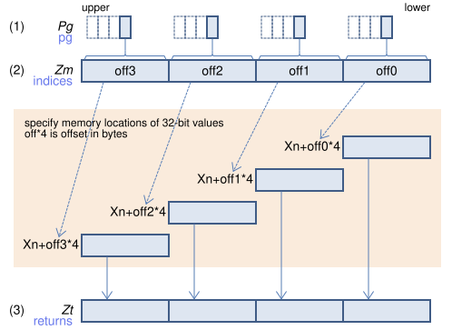
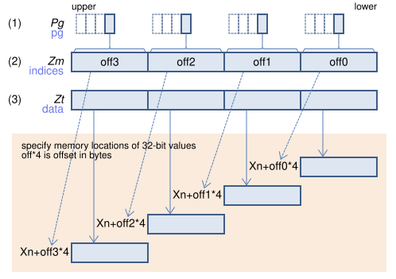
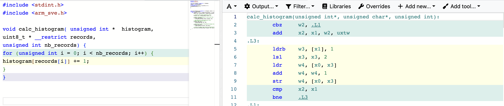
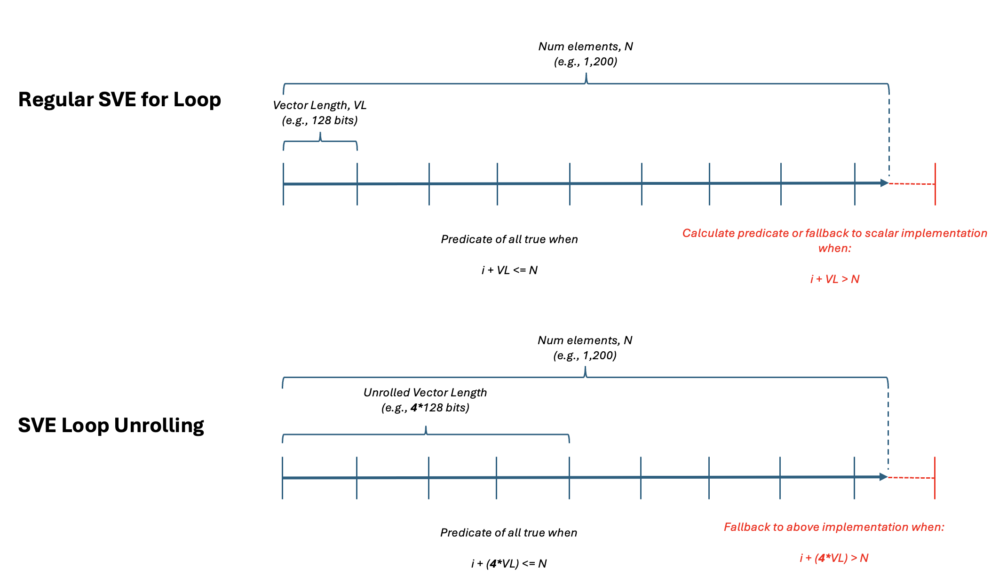

<!--
  SPDX-FileCopyrightText: Copyright 2026 Arm Limited and/or its affiliates <open-source-office@arm.com>
  SPDX-License-Identifier: BSD-3-Clause-Clear
-->

# Histogram

This task implements a histogram for input records that vary from `uint8_t` to `uint32_t`.

## What A Histogram Does

A histogram maps values to counters. For each input record, it finds the
corresponding bin and increments that bin.

For this task:
- Input values are constrained to `[0, 255]`, even when the source element type
  is `uint8_t`, `uint16_t`, or `uint32_t`.
- The histogram has 256 bins.
- Bin size is 1, so bin index equals the value.

So if `records[i] == 42`, we increment `histogram[42]`. If value 42 appears
`k` times in the input, then after processing all records, `histogram[42] == k`.

In scalar form, the core logic is:

```cpp
for (uint32_t i = 0; i < num_records; i++) {
    histogram[records[i]] += 1;
}
```

## Build

The commands below builds the histogram executable, and run the tests and microbenchmark in the optimized Release configuration:

```bash
cmake --build build --config Release --target histogram
cmake --build build --config Release --target benchmark-histogram
cmake --build build --config Release --target test-histogram
```

Use `--config Release` for benchmarking so the optimized configuration is selected. Depending on the generator and toolchain configuration, this maps to the repository's Release optimization flags.

## Testing

Test as per regular C++ unit testing (GoogleTest), and include both typical
datasets and edge cases.

One important edge case is when dataset length is smaller than the minimum SVE
vector length (128 bits). For 32-bit lanes, that means fewer than 4 elements.
This catches tail-predicate correctness issues that can be missed by only
testing larger inputs.

test snippet:

```cpp
static constexpr size_t SMALL_HISTOGRAM_SIZE =
    3; // minimum SVL length is 128 bits (i.e. 4 ints)
vector<T> small_records = vector<T>(SMALL_HISTOGRAM_SIZE);

histogram::calc_histogram_sve2<TypeParam>(
    this->small_histogram.data(),
    this->small_records.data(),
    this->small_records.size());

EXPECT_EQ(this->small_answer, this->small_histogram);
```

Raw GoogleTest output:

```output
[==========] Running 30 tests from 3 test suites.
[----------] Global test environment set-up.
[----------] 10 tests from histogramTest/0, where TypeParam = unsigned char
[ RUN      ] histogramTest/0.scalar_typed_test
[       OK ] histogramTest/0.scalar_typed_test (0 ms)
[ RUN      ] histogramTest/0.scalar_variable_bin_typed_test
[       OK ] histogramTest/0.scalar_variable_bin_typed_test (0 ms)
[ RUN      ] histogramTest/0.sve_typed_test
[       OK ] histogramTest/0.sve_typed_test (0 ms)
[ RUN      ] histogramTest/0.sve_same_vector_duplicates_typed_test
[       OK ] histogramTest/0.sve_same_vector_duplicates_typed_test (0 ms)
[ RUN      ] histogramTest/0.sve_repeated_accumulation_typed_test
[       OK ] histogramTest/0.sve_repeated_accumulation_typed_test (0 ms)
[ RUN      ] histogramTest/0.sve_scalar_update_typed_test
[       OK ] histogramTest/0.sve_scalar_update_typed_test (0 ms)
[ RUN      ] histogramTest/0.sve2_typed_test
[       OK ] histogramTest/0.sve2_typed_test (0 ms)
[ RUN      ] histogramTest/0.sve2_variable_bin_typed_test
[       OK ] histogramTest/0.sve2_variable_bin_typed_test (0 ms)
[ RUN      ] histogramTest/0.sve2_unrolled_typed_test
[       OK ] histogramTest/0.sve2_unrolled_typed_test (0 ms)
[ RUN      ] histogramTest/0.sve2_unrolled_variable_bin_typed_test
[       OK ] histogramTest/0.sve2_unrolled_variable_bin_typed_test (0 ms)
[----------] 10 tests from histogramTest/0 (0 ms total)

[----------] 10 tests from histogramTest/1, where TypeParam = unsigned short
[ RUN      ] histogramTest/1.scalar_typed_test
[       OK ] histogramTest/1.scalar_typed_test (0 ms)
[ RUN      ] histogramTest/1.scalar_variable_bin_typed_test
[       OK ] histogramTest/1.scalar_variable_bin_typed_test (0 ms)
[ RUN      ] histogramTest/1.sve_typed_test
[       OK ] histogramTest/1.sve_typed_test (0 ms)
[ RUN      ] histogramTest/1.sve_same_vector_duplicates_typed_test
[       OK ] histogramTest/1.sve_same_vector_duplicates_typed_test (0 ms)
[ RUN      ] histogramTest/1.sve_repeated_accumulation_typed_test
[       OK ] histogramTest/1.sve_repeated_accumulation_typed_test (0 ms)
[ RUN      ] histogramTest/1.sve_scalar_update_typed_test
[       OK ] histogramTest/1.sve_scalar_update_typed_test (0 ms)
[ RUN      ] histogramTest/1.sve2_typed_test
[       OK ] histogramTest/1.sve2_typed_test (0 ms)
[ RUN      ] histogramTest/1.sve2_variable_bin_typed_test
[       OK ] histogramTest/1.sve2_variable_bin_typed_test (0 ms)
[ RUN      ] histogramTest/1.sve2_unrolled_typed_test
[       OK ] histogramTest/1.sve2_unrolled_typed_test (0 ms)
[ RUN      ] histogramTest/1.sve2_unrolled_variable_bin_typed_test
[       OK ] histogramTest/1.sve2_unrolled_variable_bin_typed_test (0 ms)
[----------] 10 tests from histogramTest/1 (0 ms total)

[----------] 10 tests from histogramTest/2, where TypeParam = unsigned int
[ RUN      ] histogramTest/2.scalar_typed_test
[       OK ] histogramTest/2.scalar_typed_test (0 ms)
[ RUN      ] histogramTest/2.scalar_variable_bin_typed_test
[       OK ] histogramTest/2.scalar_variable_bin_typed_test (0 ms)
[ RUN      ] histogramTest/2.sve_typed_test
[       OK ] histogramTest/2.sve_typed_test (0 ms)
[ RUN      ] histogramTest/2.sve_same_vector_duplicates_typed_test
[       OK ] histogramTest/2.sve_same_vector_duplicates_typed_test (0 ms)
[ RUN      ] histogramTest/2.sve_repeated_accumulation_typed_test
[       OK ] histogramTest/2.sve_repeated_accumulation_typed_test (0 ms)
[ RUN      ] histogramTest/2.sve_scalar_update_typed_test
[       OK ] histogramTest/2.sve_scalar_update_typed_test (0 ms)
[ RUN      ] histogramTest/2.sve2_typed_test
[       OK ] histogramTest/2.sve2_typed_test (0 ms)
[ RUN      ] histogramTest/2.sve2_variable_bin_typed_test
[       OK ] histogramTest/2.sve2_variable_bin_typed_test (0 ms)
[ RUN      ] histogramTest/2.sve2_unrolled_typed_test
[       OK ] histogramTest/2.sve2_unrolled_typed_test (0 ms)
[ RUN      ] histogramTest/2.sve2_unrolled_variable_bin_typed_test
[       OK ] histogramTest/2.sve2_unrolled_variable_bin_typed_test (0 ms)
[----------] 10 tests from histogramTest/2 (0 ms total)

[----------] Global test environment tear-down
[==========] 30 tests from 3 test suites ran. (0 ms total)
[  PASSED  ] 30 tests.
```


## Implementation

### Steps To Vectorize With SVE

The SVE path intentionally avoids SVE gather/scatter in the benchmarked implementation. The hot operation is still an indirect histogram update, but on the benchmark target the SVE gather/scatter read-modify-write path was slower than using SVE for loading/index preparation and scalar stores for the counter updates.

The benchmarked SVE implementation follows this hybrid pattern:

1. Build a per-lane predicate with `svwhilelt_b32(i, n)` for safe tail handling.
```cpp
svbool_t pg = svwhilelt_b32(i, n);
```
2. Load records into 32-bit bin indices with the templated `load<T>()` helper.
```cpp
svuint32_t idx = load<T>(pg, &records[i]);
```
3. Detect the common benchmark case where active lanes contain contiguous indices.
```cpp
svuint32_t contiguous_idx = svindex_u32(first_idx, 1);
svbool_t is_contiguous = svcmpeq_u32(pg, idx, contiguous_idx);
```
4. For contiguous chunks, update bins directly with scalar stores without spilling the vector of indices.
```cpp
for (uint64_t lane = 0; lane < lanes; ++lane) {
    histogram[first_idx + lane] += 1;
}
```
5. For non-contiguous chunks, spill active SVE lanes into a small stack buffer and update scalar bins from that buffer.
```cpp
svst1_u32(pg, idx_buf, idx);
for (uint64_t lane = 0; lane < lanes; ++lane) {
    histogram[idx_buf[lane]] += 1;
}
```

#### Why Avoid Gather/Scatter In The SVE Benchmark

A histogram update is an indirect read-modify-write: each record chooses which counter is incremented. SVE gather/scatter can express that access pattern, but for this unary 256-bin benchmark the gathered values are tiny, the SVE vector length on the measured target is short, and the update still needs duplicate-index care. The scalar-update hybrid avoids the vector gather/scatter overhead while retaining SVE predication, widening loads, and vector-length-agnostic tail handling.

There is also a full SVE gather/scatter implementation in `histogram.cpp` named `calc_histogram_sve`. It is useful to study and can be benchmarked by uncommenting its registrations in `benchmark.cpp`, but on the measured target it was slower: about `0.63 N` BigO compared with about `0.53 N` for the scalar-update SVE hybrid.

### Steps To Vectorize With SVE2

The SVE2 path follows a gather/update/scatter pattern:

1. Build a per-lane predicate with `svwhilelt_b32(i, n)` for safe tail handling.
```cpp
svbool_t pg = svwhilelt_b32(i, n);
```
2. Load records into 32-bit bin indices with the templated `load<T>()` helper.
```cpp
svuint32_t idx = load<T>(pg, &records[i]);
```
3. Gather current bin values with `svld1_gather_u32index_u32`.
```cpp
svuint32_t old_counts = svld1_gather_u32index_u32(pg, histogram, idx);
```


Gather (load) 32-bit values into (3), from a base address (Xn/base), plus each corresponding sign-or-zero-extended 32-bit offset from (2) multiplied by four. If the predicate bit from (1) corresponding to an element in (3) is zero, that load is skipped, and cannot cause a fault, and the element is set to zero

4. Compute per-lane duplicate counts with `svhistcnt_u32_z`.
```cpp
svuint32_t dup_counts = svhistcnt_u32_z(pg, idx, idx);
```
5. Add increments (`svadd_u32_m`) and scatter back (`svst1_scatter_u32index_u32`).
```cpp
svuint32_t new_counts = svadd_u32_m(pg, old_counts, dup_counts);
svst1_scatter_u32index_u32(pg, histogram, idx, new_counts);
```



#### Why gather load is required

Histogram updates are indirect accesses: each lane updates
`histogram[idx[lane]]`, and `idx` values are generally non-contiguous.
A normal vector load/store assumes contiguous memory and cannot express this
pattern. Gather/scatter instructions are designed for exactly this case.

#### Why zero-extension is used

For `uint8_t` and `uint16_t` records, the implementation loads directly into
`svuint32_t` with:
- `svld1ub_u32` for 8-bit input
- `svld1uh_u32` for 16-bit input

This performs zero-extension to 32-bit lane values. That is correct because
record values are non-negative, so zero-extension preserves numeric value and
produces indices in the unsigned domain expected by gather/scatter operations.

### Why Per-Lane Duplicate Counts Are Needed

Histogram updates are not independent when multiple active lanes target the same
bin in the same vector step. If we only gathered once and added `1` per lane,
then two or more lanes with the same index would read the same old value and
overwrite each other on scatter.

Concrete example:
- Suppose lanes contain indices `[42, 42, 42, 7]`.
- Bin `42` should be incremented by `3`, not `1`.

The implementation solves this by computing per-lane duplicate counts before the
update:

```cpp
svuint32_t dup_counts = svhistcnt_u32_z(pg, idx, idx);
svuint32_t new_counts = svadd_u32_m(pg, old_counts, dup_counts);
```

`svhistcnt_u32_z` (HISTCNT) counts, for each active lane, how many active lanes
match the same key value (here, key and data are both `idx`). In other words,
it generates the correct increment amount per lane under duplicate indices, so
the gather/add/scatter sequence remains logically correct.

### Comparing With Compiler Autovectorization

The scalar reference loop is simple:

```cpp
for (uint32_t i = 0; i < num_records; i++) {
    histogram[records[i]] += 1;
}
```

However, this pattern is an indirect read-modify-write with potential intra-loop
conflicts (multiple iterations can target the same bin). In practice, this is
hard for auto-vectorizers to transform safely into the SVE2 gather/conflict
resolution pattern.



In the provided Compiler Explorer reference:

https://godbolt.org/z/vxaMcjG4r

the scalar implementation is not lowered to the SVE2 histogram sequence, and
the HISTCNT instruction is not emitted. That is why this task uses explicit SVE2
intrinsics to express operations that current autovectorization does not infer.

### Template Metaprogramming With SVE2

SVE2 intrinsics are type-specific APIs, and not every operation can be written
as one generic call for all element types. In particular, intrinsics that only
accept scalar pointer arguments (for example, load forms) do not infer a
different vector return type based on the template parameter in the way we need.

Because of that, C++ metaprogramming must explicitly select the intrinsic using
`if constexpr` and type constraints:

```cpp
template <ValidSVEType T>
INLINE svuint32_t load(svbool_t pred, const T *records) {
    if constexpr (std::same_as<T, uint8_t>) {
        return svld1ub_u32(pred, records);
    } else if constexpr (std::same_as<T, uint16_t>) {
        return svld1uh_u32(pred, records);
    } else {
        return svld1(pred, records);
    }
}
```

Inlining this helper is important here. If the helper is not
inlined, call overhead and weaker optimization across the load path can cause a
measurable performance regression in a tight histogram loop.

### Optimizations

The unrolled SVE2 implementation processes 4 vectors each iteration:

```txt
i += 4 * VL
```

where `VL` is runtime vector length in 32-bit lanes (`svcntw()`).

Salient unrolled-path snippet:

```cpp
const svbool_t pg_all = svptrue_b32();
for (; i + (4 * vl) <= n; i += (4 * vl)) {
    svuint32_t idx0 = load<T>(pg_all, &records[i]);
    svuint32_t idx1 = load<T>(pg_all, &records[i + vl]);
    svuint32_t idx2 = load<T>(pg_all, &records[i + 2 * vl]);
    svuint32_t idx3 = load<T>(pg_all, &records[i + 3 * vl]);
    // gather/update/scatter for each idxX
}
```



It uses two predicate strategies:
- Fast full-lane predicate: `svptrue_b32()` (`pg_all`) in the main unrolled
  loop, when we already know `i + 4*VL <= n`.
- Tail-safe predicate: `svwhilelt_b32(i, n)` for remainder processing.

Tradeoffs:
- If data size is usually large and often near multiples of `VL` (or `4*VL`),
  spending more work in the `pg_all` loop is typically beneficial due to less
  predicate-generation overhead and better throughput.
- If data size is frequently small, irregular, or dominated by tails,
  repeatedly using `svwhilelt_b32` may be simpler and can avoid over-optimizing
  for a main loop that executes only a few iterations.
- If data size is expected to be a multiple of 2 vectors or more, partial
  unrolling can be a compromise: some ILP benefit with less code expansion than
  4-way unrolling.


## Benchmarking And Analysis

Build the Release benchmark binary before collecting timings:

```bash
cmake --build build/ --config Release --target benchmark
```

Useful benchmark filters:

```bash
# Compare scalar, SVE scalar-update hybrid, SVE2, and SVE2 unrolled at uint8_t precision.
./build/benchmark/Release/benchmark \
  --benchmark_filter='histogram_(scalar|sve_scalar_update|sve2|sve2_unrolled)<uint8_t>'

# Compare the same implementations across uint8_t, uint16_t, and uint32_t.
./build/benchmark/Release/benchmark \
  --benchmark_filter='histogram_(scalar|sve_scalar_update|sve2|sve2_unrolled)<uint(8|16|32)_t>'

# Run only the benchmarked SVE scalar-update hybrid.
./build/benchmark/Release/benchmark \
  --benchmark_filter='histogram_sve_scalar_update<uint(8|16|32)_t>'

# Run only the SVE2 implementations.
./build/benchmark/Release/benchmark \
  --benchmark_filter='histogram_sve2(_unrolled)?<uint(8|16|32)_t>'
```

### BigO Speedup Summary

The table below uses the Google Benchmark `_BigO` values from a Release run. Speedup is computed as:

```txt
speedup = scalar_BigO / implementation_BigO
```

The `SVE` row refers to the benchmarked SVE scalar-update hybrid, `histogram_sve_scalar_update<T>`.

| Implementation | `uint8_t` | `uint16_t` | `uint32_t` |
|---|---:|---:|---:|
| Scalar | 1.00x | 1.00x | 1.00x |
| SVE | 0.89x | 0.89x | 0.92x |
| SVE2 | 1.12x | 1.12x | 1.14x |
| SVE2 unrolled | 1.27x | 1.20x | 1.29x |

Raw BigO values used for the table:

| Implementation | `uint8_t` BigO | `uint16_t` BigO | `uint32_t` BigO |
|---|---:|---:|---:|
| Scalar | `0.47 N` | `0.48 N` | `0.49 N` |
| SVE scalar-update | `0.53 N` | `0.54 N` | `0.53 N` |
| SVE2 | `0.42 N` | `0.43 N` | `0.43 N` |
| SVE2 unrolled | `0.37 N` | `0.40 N` | `0.38 N` |

Observations:
- The SVE scalar-update hybrid is faster than the full SVE gather/scatter experiment on this target, but it is still slightly slower than the scalar baseline.
- SVE2 is faster than scalar because `HISTCNT` handles duplicate lanes directly in vector registers.
- The unrolled SVE2 path is the fastest measured implementation because it reduces loop overhead and exposes more independent work per iteration.
- Precision has modest impact because benchmark records are normalized to `[0, 255]`; the dominant cost is indirect histogram traffic and conflict handling, not arithmetic width.
