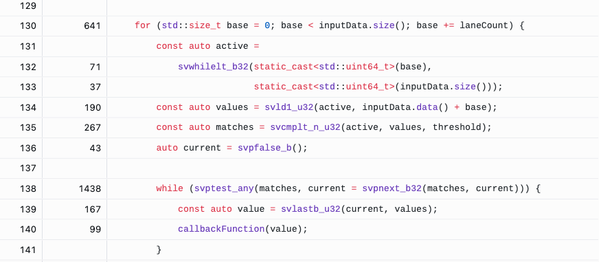

<!--
  SPDX-FileCopyrightText: Copyright 2026 Arm Limited and/or its affiliates <open-source-office@arm.com>
  SPDX-License-Identifier: BSD-3-Clause-Clear
-->

# Match and visit

### How can SVE find values in parallel when each match still requires ordered scalar processing?

# Introduction

## About this module

Many applications scan arrays to find interesting values and then perform work
that is difficult or unsafe to vectorize. Examples include invoking callbacks,
updating state machines, processing matches in input order, or stopping after a
particular match.

In this module, you will compare three implementations of a threshold scan:

| Implementation | Purpose |
|---|---|
| `matchAndVisitScalar` | Scalar reference implementation |
| `matchAndVisitSVEBasic` | Parallel comparison followed by sequential `PNEXT` processing |
| `matchAndVisitSVEOptimized` | Reduced loop overhead while retaining `PNEXT` and callback order |

An additional `matchAndVisitSVECompact` implementation is available as an optional
exercise.

Every implementation passes each input value below the threshold to a scalar
callback exactly once and in its original input order. The aim is not merely to
use SVE, but to decide how parallel matching and sequential work should be
combined.

## What will you be able to do?

By the end of this module, you will be able to:

- build and run the scalar and SVE match-and-visit implementations;
- explain how `svpnext_b32` selects matching lanes sequentially;
- explain how `svlastb_u32` extracts the value selected by `svpnext_b32`;
- identify the loop overhead in the basic SVE implementation;
- compare the basic and optimized SVE benchmark results;
- use QEMU to check vector-length-agnostic correctness; and
- identify workloads for which `PNEXT` or `svcompact` may be more suitable.

# Before you begin

## Understand match and visit

The scan receives:

- a vector of unsigned 32-bit values;
- an unsigned 32-bit threshold; and
- a callback that accepts one matching value.

A value matches when it is strictly less than the threshold. Although SVE can
compare multiple values at once, the callback is intentionally scalar and must
be called in input order.

The example uses `uint32_t`. For a fixed SVE vector length, narrower element
types provide more lanes and therefore more opportunities for matches in each
vector. A 32-bit element gives more lanes than a 64-bit element without the
very high lane counts of 8-bit or 16-bit data, and it matches the natural data
type used by this example.

## Prerequisites

Before starting, you need:

- an AArch64 system with SVE, or QEMU user-mode emulation;
- CMake 3.20 or later;
- Ninja;
- a C++20 compiler with Arm SVE intrinsics support; and
- basic familiarity with SVE predicates and vector-length-agnostic loops.

# Plan the match-and-visit workflow

You will:

1. build and run the scalar and SVE implementations;
2. inspect how `svpnext_b32` and `svlastb_u32` process matches;
3. run correctness tests;
4. benchmark the basic and optimized implementations;
5. profile the basic implementation to find its bottleneck;
6. inspect the optimized `PNEXT` approach; and
7. test all vector lengths supported by the repository's QEMU wrapper.

## Repository and workflow assets

| Path | Purpose |
|---|---|
| `match_and_visit/match_and_visit.cpp` | Scalar, basic SVE, optimized SVE, and compact implementations |
| `match_and_visit/main.cpp` | Small executable that prints the callback count |
| `match_and_visit/test.cpp` | Correctness and ordering tests |
| `match_and_visit/benchmark.cpp` | Match-density benchmarks |
| `cmake/qemu-wrapper.sh.in` | QEMU launcher with selectable SVE vector lengths |

# Complete the match-and-visit workflow

## 1. Build and run the implementations

Build `match_and_visit` in Release mode:

```bash
cmake --build build --config Release --target match_and_visit
```

Release is the default configuration used throughout this module unless a step
explicitly requests Debug.

Run the scalar implementation:

```bash
build/match_and_visit/Release/match_and_visit scalar
```

Captured output:

```text
Callback count: 8
```

Run the optimized SVE implementation:

```bash
build/match_and_visit/Release/match_and_visit sve
```

Captured output:

```text
Callback count: 8
```

Both paths invoke the callback eight times. The unit tests later in the module
verify that the callbacks also receive the same values in input order. Values
equal to the threshold do not match because the comparison is strictly less
than.

## 2. Find matches in parallel

The main loop in `matchAndVisitSVEBasic` begins by asking SVE how many 32-bit
lanes are available:

```cpp
const auto laneCount = static_cast<size_t>(svcntw());
```

The implementation then processes one vector at a time:

```cpp
const auto active =
    svwhilelt_b32(static_cast<uint64_t>(base),
                  static_cast<uint64_t>(inputData.size()));
const auto values = svld1_u32(active, inputData.data() + base);
const auto matches = svcmplt_n_u32(active, values, threshold);
```

These operations:

1. use `svwhilelt_b32` to create a predicate for the current full or partial
   vector;
2. use `svld1_u32` to load active values; and
3. use `svcmplt_n_u32` to compare all active lanes with the scalar threshold.

At this point, matching is parallel. The `matches` predicate records which
lanes require scalar callback work.

## 3. Process matching lanes with `PNEXT`

The basic implementation initializes an empty predicate and enters the
match-processing loop:

```cpp
auto current = svpfalse_b();

while (svptest_any(matches, current = svpnext_b32(matches, current))) {
    const auto value = svlastb_u32(current, values);
    callbackFunction(value);
}
```

[`svpnext_b32`](https://developer.arm.com/architectures/instruction-sets/intrinsics/#q=svpnext)
advances through active 32-bit elements of the `matches` predicate:

1. `current` initially contains no active lanes.
2. The first call returns a predicate selecting the first active lane in
   `matches`.
3. The next call returns a predicate selecting the next active lane after the
   lane selected by `current`.
4. Calls continue in increasing lane order.
5. After the final match, `svpnext_b32` returns an empty predicate.
6. `svptest_any` detects the empty result and terminates the loop.

The predicate returned for a successful step identifies one matching lane.
`svlastb_u32(current, values)` returns the last active 32-bit element of
`values` under `current`. Because `current` identifies the current single
matching lane, this extracts exactly the scalar value required by the callback.

### Trace a non-contiguous match pattern

Suppose a vector has eight 32-bit lanes:

```text
Lane:       0   1   2   3   4   5   6   7
Value:     12   3  11   8  14   2  15   4
Matches:    F   T   F   T   F   T   F   T
```

For a threshold of 10, the loop behaves as follows:

| Iteration | Lane selected by `svpnext_b32` | Value from `svlastb_u32` |
|---|---:|---:|
| 1 | 1 | 3 |
| 2 | 3 | 8 |
| 3 | 5 | 2 |
| 4 | 7 | 4 |
| 5 | None | Loop terminates |

The comparison is vectorized, but the matching values are extracted and passed
to the callback sequentially as `3, 8, 2, 4`. This preserves input order even
when matching lanes are non-contiguous.

### Decide when `PNEXT` is appropriate

`PNEXT` is useful when the vector operation can identify work in parallel but
the work for each active lane must remain sequential. Examples include:

- ordered callbacks with observable side effects;
- state-machine transitions where one match affects the next;
- variable-cost processing for individual matches;
- stopping after a particular matching value; and
- sparse matches where packing every vector may add unnecessary work.

The loop is intentionally serial across matching lanes. This is a feature when
the callback cannot be vectorized, but it may also become the performance
bottleneck as the number of matches increases.

## 4. Check correctness

Run the focused `match_and_visit` tests:

```bash
cmake --build build --config Release --target test-match_and_visit
```

Captured summary:

```text
[==========] Running 5 tests from 1 test suite.
[==========] 5 tests from 1 test suite ran. (3 ms total)
[  PASSED  ] 5 tests.
```

The tests cover:

- scalar callback order;
- empty, no-match, and all-match inputs;
- duplicate values and input order;
- multiple vectors and a partial tail; and
- strict unsigned comparison.

## 5. Benchmark the basic `PNEXT` loop

Run a focused Release benchmark at a callback probability of 1000 basis points,
which means 10% of the input values match:

```bash
build/benchmark/Release/benchmark \
  --benchmark_filter='^match_and_visit_(scalar|sve_basic|sve_optimized)/callback_probability_basis_points:1000$' \
  --benchmark_min_time=0.05s
```

The following output was captured on one system. Absolute timings and relative
performance will vary with the processor, SVE vector length, compiler, and
system load:

```text
Benchmark                                                           Time
match_and_visit_scalar/callback_probability_basis_points:1000         18979 ns
match_and_visit_sve_optimized/callback_probability_basis_points:1000    6287 ns
match_and_visit_sve_basic/callback_probability_basis_points:1000       10878 ns
```

On this system, the basic SVE implementation was faster than the scalar
reference, but the optimized SVE implementation reduced the time further. Use
measurements from your own target when drawing performance conclusions.

## 6. Profile the basic implementation

This profiling exercise is optional. To reproduce it, use a sample-based
profiler such as [Linux `perf`](https://learn.arm.com/install-guides/perf/) or
[Arm Performix](https://learn.arm.com/install-guides/performix/). If neither
tool is available, use the Performix capture below as a reference for the
expected result.

Generate a Debug benchmark binary with source-level debug information:

```bash
cmake --build build/ --config Debug --target benchmark
```

The generated binary is:

```text
build/benchmark/Debug/benchmark
```

Run the focused benchmark while sampling is active:

```bash
build/benchmark/Debug/benchmark \
  --benchmark_filter='^match_and_visit_sve_basic/callback_probability_basis_points:1000$' \
  --benchmark_min_time=5s
```

A shorter run on the test system produced:

```text
match_and_visit_sve_basic/callback_probability_basis_points:1000
    92036 ns   callbacks=1.638k   items_per_second=178.05M/s
```

Debug timings are not suitable for comparing implementation performance.
The Debug build is used to make sampled instructions easier to associate with
source code.

Before profiling, predict where samples will accumulate. The likely bottleneck
is the `while` loop in `matchAndVisitSVEBasic`: every match executes `PNEXT`,
extracts a scalar value with `svlastb_u32`, tests the predicate, invokes the
callback, and branches back around the loop. Confirm this expectation with
profiling evidence on your target rather than assuming it is universally true.



*Arm Performix source view for `matchAndVisitSVEBasic`. The `PNEXT` while loop has
the largest sample count in this capture, supporting the bottleneck hypothesis
for this workload and system. Exact sample percentages vary by processor, but a
similar hotspot distribution is expected across Arm Neoverse versions.*

## 7. Reduce `PNEXT` loop overhead

`matchAndVisitSVEOptimized` uses `svcntp_b32` to count the matching lanes and
skips vectors with no matches. It passes the remaining work to
`processPnextMatches`:

```cpp
INLINE void processPnextMatches(svuint32_t values, svbool_t matches,
                                size_t matchCount, uint32_t *matchedValues,
                                const MatchCallback &callbackFunction) {
    if (matchCount == 0) {
        return;
    }

    auto current = svpfalse_b();
    size_t i = 0;

    // This cutoff is a tuning heuristic; benchmark it for the target processor
    // and configuration.
    if (matchCount <= 3) {
        uint32_t firstValue = 0;
        uint32_t secondValue = 0;
        uint32_t thirdValue = 0;

        if (matchCount >= 1) {
            current = svpnext_b32(matches, current);
            firstValue = svlastb_u32(current, values);
        }
        if (matchCount >= 2) {
            current = svpnext_b32(matches, current);
            secondValue = svlastb_u32(current, values);
        }
        if (matchCount == 3) {
            current = svpnext_b32(matches, current);
            thirdValue = svlastb_u32(current, values);
        }

        callbackFunction(firstValue);
        if (matchCount == 1) {
            return;
        }

        callbackFunction(secondValue);
        if (matchCount == 2) {
            return;
        }

        callbackFunction(thirdValue);
        return;
    }

    // Knowing matchCount avoids svptest_any after each PNEXT. Unroll complete
    // groups of four to reduce extraction-loop control overhead.
    while (i + 4 <= matchCount) {
        current = svpnext_b32(matches, current);
        matchedValues[i] = svlastb_u32(current, values);

        current = svpnext_b32(matches, current);
        matchedValues[i + 1] = svlastb_u32(current, values);

        current = svpnext_b32(matches, current);
        matchedValues[i + 2] = svlastb_u32(current, values);

        current = svpnext_b32(matches, current);
        matchedValues[i + 3] = svlastb_u32(current, values);
        i += 4;
    }

    for (; i < matchCount; ++i) {
        current = svpnext_b32(matches, current);
        matchedValues[i] = svlastb_u32(current, values);
    }

    processMatches(matchedValues, matchCount, callbackFunction);
}
```

Starting with an empty `current` predicate, each `svpnext_b32` selects the next
matching lane and `svlastb_u32` extracts its value, preserving lane order. The
cutoff of three is a performance heuristic rather than an SVE requirement: it
handles counts too small for one group of four without using the buffer, and
should be validated for the target processor and configuration.

Because `matchCount` is known, the function does not need `svptest_any` after
each `PNEXT` to determine whether another match exists. The `while` loop is
manually unrolled by four: `i + 4 <= matchCount` means that at least four values
remain, and the following `for` loop extracts the final zero to three values.
`processMatches` then visits the buffered values in order. This shared helper
directly dispatches counts up to three and uses a scalar loop for larger counts;
this `processPnextMatches` path reaches it only for larger counts. The potential
performance increase comes from avoiding per-match predicate tests and reducing
extraction-loop control overhead; the callbacks themselves remain scalar.

Review the benchmark results and the profiler output together. A speed-up is
useful evidence, but the evidence is stronger when profiling also shows that
the expected hot loop has changed.

## 8. Check vector-length-agnostic correctness with QEMU

QEMU can test SVE code on an AArch64 development system without SVE hardware.
Install QEMU user-mode emulation if required:

```bash
sudo apt update
sudo apt install qemu-user
```

Use a separate single-configuration build directory so that the native
multi-configuration build remains unchanged:

```bash
cmake -S . -B build-qemu -G Ninja \
  -DCMAKE_BUILD_TYPE=Release \
  -DSTBC_SVE_CROSS_COMPILE=ON
cmake --build build-qemu
```

CMake searches for `qemu-aarch64` or `qemu-aarch64-static`. If QEMU is in a
non-standard location, configure with:

```bash
cmake -S . -B build-qemu -G Ninja \
  -DCMAKE_BUILD_TYPE=Release \
  -DSTBC_SVE_CROSS_COMPILE=ON \
  -DSTBC_QEMU_EXECUTABLE=/path/to/qemu-aarch64
```

Run the tests at every vector length accepted by the repository's QEMU wrapper:

```bash
STBC_SVE_VL=128  cmake --build build-qemu -t test-all
STBC_SVE_VL=256  cmake --build build-qemu -t test-all
STBC_SVE_VL=512  cmake --build build-qemu -t test-all
STBC_SVE_VL=1024 cmake --build build-qemu -t test-all
STBC_SVE_VL=2048 cmake --build build-qemu -t test-all
```

The `test-all` target checks every task in the repository. To run only the
`match_and_visit` tests through the QEMU wrapper generated by CMake:

```bash
for vl in 128 256 512 1024 2048; do
  echo "Testing SVE vector length ${vl} bits"
  STBC_SVE_VL="${vl}" \
    build-qemu/qemu-wrapper.sh \
    build-qemu/test/test \
    --gtest_color=no \
    --gtest_filter='match_and_visit*'
done
```

The focused matrix was run with QEMU and produced this summary at every vector
length:

```text
STBC_SVE_VL=128:  [  PASSED  ] 5 tests.
STBC_SVE_VL=256:  [  PASSED  ] 5 tests.
STBC_SVE_VL=512:  [  PASSED  ] 5 tests.
STBC_SVE_VL=1024: [  PASSED  ] 5 tests.
STBC_SVE_VL=2048: [  PASSED  ] 5 tests.
```

These tests check that predicates, loop increments, tail handling, and match
ordering do not depend on one SVE vector length.

QEMU is appropriate for correctness testing, not performance analysis.
Benchmark timings collected under QEMU do not represent SVE hardware
performance.

## 9. Optional exercise: compare `PNEXT` with `svcompact`

There are usually several valid ways to implement a scan. The
`matchAndVisitSVECompact` implementation uses:

```cpp
svcompact_u32(matches, values)
```

This packs matching values into consecutive low-numbered lanes. The
implementation stores those packed values and then processes them with the
same ordered scalar callback.

The compact implementation remains in the source, correctness tests, and
benchmark registrations. As an optional exercise:

1. rebuild the Release benchmark;
2. compare `svcompact` with the basic and optimized `PNEXT` implementations;
3. repeat the comparison for sparse and dense match probabilities; and
4. explain which implementation best suits each match density.

`svcompact` may be attractive when many matches should be materialized and
processed uniformly. `PNEXT` may be more suitable when matches are sparse,
processing can stop early, or each selected lane immediately controls
stateful, ordered, or variable-cost work.

# Review the evidence from the workflow

The match-and-visit operation separates two kinds of work:

- SVE performs the load and threshold comparison in parallel.
- `PNEXT` and `svlastb` bridge matching predicate lanes to ordered scalar work.

The basic implementation expresses this directly, but performs a predicate
advance, scalar extraction, callback, test, and branch for each match. The
optimized implementation retains the same semantics while reducing control
overhead and separating extraction from callback processing.

Use three forms of evidence before selecting an implementation:

1. correctness tests, including multiple SVE vector lengths;
2. Release benchmark measurements on the target hardware; and
3. sampled profiles that identify where execution time is spent.

## Generalise the technique

The same approach can be used whenever a vector predicate identifies elements
that require non-vector work. Before choosing `PNEXT`, ask:

- Must matching elements be processed in order?
- Can processing stop before every match is visited?
- Does one match modify state needed by the next?
- Are matches expected to be sparse or dense?
- Is it better to handle each match immediately or materialize all matches?

The answers determine whether sequential predicate traversal, compaction, or a
different algorithm is the best fit.

# Check your understanding

1. Why does `current` start as `svpfalse_b()` before the first
   `svpnext_b32` call?
2. What causes the basic `while` loop to terminate?
3. Why does `svlastb_u32(current, values)` return the intended matching value?
4. Which parts of `matchAndVisitSVEBasic` are parallel, and which are sequential?
5. Why might a dense match predicate make the basic implementation expensive?
6. When could `PNEXT` be preferable to `svcompact`?
7. Why should QEMU results be used for correctness rather than performance?

# Apply the match-and-visit conclusion

Use `PNEXT` when vector code can identify candidates in parallel but selected
lanes must drive ordered scalar work. Combine it with `svlastb` to extract each
selected value, and profile the resulting loop when matches may be frequent.

Do not assume that the simplest `PNEXT` loop or `svcompact` is always fastest.
Measure representative match densities, confirm correctness across vector
lengths, and choose the implementation that best matches the ordering,
state-management, and performance requirements of the application.

## Further reading

- Arm C Language Extensions for SVE intrinsics, including `svpnext`,
  `svlastb`, `svcntp`, and `svcompact`;
- the cross-compilation and QEMU guidance in the repository-level
  `README.md`; and
- `match_and_visit/match_and_visit.cpp` for the complete implementations discussed in
  this module.
