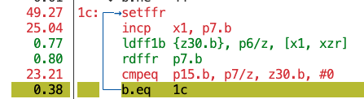
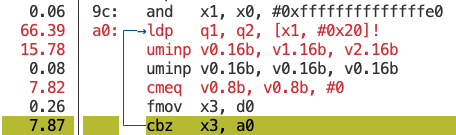

<!--
  SPDX-FileCopyrightText: Copyright 2026 Arm Limited and/or its affiliates <open-source-office@arm.com>
  SPDX-License-Identifier: BSD-3-Clause-Clear
-->

# Optimize C-string length with SVE

### When does an SVE `strlen` implementation beat a scalar loop, and when should you use the C++ or system-library alternative?

# Introduction

## About this module

C and C++ programs frequently receive null-terminated strings through operating
system interfaces, parsers, protocols, and C libraries. A C string does not
store its length, so `strlen` must inspect bytes until it finds `'\0'`.

C++ `string` is different. It stores its length as part of the object, so
calling `s.length()` or `s.size()` on an existing `string` is constant
time. However, constructing a `string` from `const char *` still requires
the implementation to:

1. scan the C string to find `'\0'`;
2. allocate storage when the text does not fit the small-string buffer;
3. copy the characters into the new object.

Converting a C string to `string` is therefore not a faster way to discover
its length. It is useful when the program also needs ownership and the other
facilities provided by `string`.

In this module, you will compare:

| Implementation | Purpose |
|---|---|
| `str::strlen` | Simple scalar reference implementation |
| `std::strlen` | Optimized system-library implementation |
| `str::strlenSVENaive` | First SVE implementation with an avoidable hot-loop cost |
| `str::strlenSVEImproved` | Intermediate implementation with the FFR setup moved outside the loop |
| `str::strlenSVESimdLoops` | More complete implementation based on the Arm SIMD Loops project |

The aim is not to show that intrinsics always beat the standard library. The
aim is to use correctness tests, compiler output, profiling, and benchmarks to
identify an avoidable cost and then understand the remaining trade-offs.

## What will you be able to do?

By the end of this module, you will be able to:

- explain why a C string must be scanned but an existing `string` does not;
- explain how SVE first-faulting loads and the First-Fault Register protect a
  vectorized string scan;
- identify `setffr` in a sampled hot loop;
- move invariant FFR setup out of the common loop path;
- compare the naive, improved, SIMD Loops, and library implementations;
- explain how string length and SVE vector length affect the expected result;
- use the course CMake QEMU support to test vector-length-agnostic behavior.

# Before you begin

## Understand the scalar operation

The scalar implementation starts at the first character and advances one byte
at a time:

```cpp
size_t strlen(const char *s) {
    const char *e = s;
    while (*e != '\0') {
        e++;
    }
    return e - s;
}
```

If the string has length `n`, the loop reads approximately `n + 1` bytes,
including the null terminator. Its complexity is therefore `O(n)`.

An existing `string` stores `n` in the object:

```cpp
string text = "hello";
const size_t length = text.length();
```

That lookup is `O(1)`. In a local experiment on the system used for this
module, reading `length()` from an existing object took approximately `0.36 ns`
for every tested size.

Do not confuse that operation with construction:

```cpp
const char *input = get_c_string();
string text(input);
const size_t length = text.length();
```

The constructor must first scan `input`, then normally copy it. At 1 MiB, the
measured construction-plus-length time was approximately `42.8 us`, compared
with `23.4 us` for `std::strlen`.

## Prerequisites

You need:

- an AArch64 system with SVE for native performance measurements;
- GCC 13 or later, or Clang 18 or later;
- CMake 3.20 or later and Ninja;
- Google Benchmark and GoogleTest, installed by the course build;
- Linux `perf` with permission to sample user-space performance events;
- QEMU user-mode emulation for the vector-length checks.

Profiling can be restricted by `kernel.perf_event_paranoid`. Check it with:

```sh
cat /proc/sys/kernel/perf_event_paranoid
```

If `perf record` reports that access is limited, ask the system administrator
for profiling access. Do not interpret an empty profile as evidence that the
function has no hot instructions.

If `perf` is not installed, follow the full
[Linux perf installation guide](https://learn.arm.com/install-guides/perf/).

## Prepare the native build

From the repository root, build the task executable, its tests and benchmarks in Release mode with:

```sh
cmake --build build --config Release --target strlen
```

The focused test target runs the same scalar and boundary cases against all four
course implementations.

# Plan the optimization workflow

| Step | Action | Evidence |
|---:|---|---|
| 1 | Benchmark the starting implementations | Time and throughput across the size sweep |
| 2 | Understand first-faulting loads and FFR | Correctness model for unknown-length input |
| 3 | Profile `strlenSVENaive` | `setffr` appears in the repeated hot loop |
| 4 | Benchmark `strlenSVEImproved` | Cost of removing repeated FFR setup |
| 5 | Compare the SIMD Loops implementation | Effect of alignment and conditional FFR reset |
| 6 | Vary SVE vector length under QEMU | Vector-length-agnostic correctness and loop-count expectations |

# Complete the optimization workflow

## 1. Establish the scalar and library baselines

Run the task benchmark through the CMake target:

```sh
cmake --build build --config Release --target benchmark-strlen
```

The benchmark uses:

```cpp
BENCHMARK(...)->RangeMultiplier(4)->Range(1, 1 << 20);
```

The resulting sweep is:

```text
1, 4, 16, 64, 256, 1024, ... 1048576 bytes
```

Each case uses the same null-terminated input for every implementation.

The system-library implementation is an important baseline. `std::strlen` can
use carefully tuned assembly, word-at-a-time techniques, architecture-specific
dispatch, and implementation knowledge that a simple course function does not
have.

## 2. Understand first-faulting loads

A vector implementation wants to inspect several bytes at once. The difficulty
is that `strlen` does not know how many bytes are safe to read.

Consider a string whose terminator is close to the end of a mapped page:

```text
mapped page                         unmapped page
... 'h' 'i' '\0' |                 |
                  ^ page boundary
```

A normal vector load that crosses the page boundary can fault even though the
string terminator appears in the mapped page.

SVE provides first-faulting loads for this kind of speculative scan:

```cpp
svsetffr();
const svuint8_t bytes = svldff1_u8(pg, cursor);
const svbool_t loaded = svrdffr_z(pg);
```

The important operations are:

- `svsetffr()` marks the First-Fault Register lanes as available;
- `svldff1_u8()` loads bytes until a memory fault prevents later lanes from
  completing;
- `svrdffr_z()` returns a predicate identifying the lanes that loaded
  successfully.

The implementation compares only successfully loaded bytes with zero:

```cpp
const svbool_t zeros = svcmpeq_n_u8(loaded, bytes, 0);
```

If no zero is present, it advances by the number of successfully loaded bytes.

The FFR is required for safe progress after a partial first-faulting load. It
does not necessarily need to be reset before every load. When a complete load
succeeds, all lanes remain available.

## 3. Walk through `strlenSVENaive`

The naive implementation performs this sequence inside every iteration:

```cpp
while (true) {
    svsetffr();
    const svuint8_t bytes = svldff1_u8(pg, cursor);
    const svbool_t loaded = svrdffr_z(pg);
    const svbool_t zeros = svcmpeq_n_u8(loaded, bytes, 0);

    if (svptest_any(loaded, zeros)) {
        const svbool_t before_zero = svbrkb_b_z(loaded, zeros);
        const auto index =
            static_cast<size_t>(svcntp_b8(pg, before_zero));
        return static_cast<size_t>(cursor - start) + index;
    }

    cursor += static_cast<size_t>(svcntp_b8(pg, loaded));
}
```

The algorithm is:

1. prepare FFR;
2. attempt one vector load;
3. read which lanes succeeded;
4. test for zero;
5. count bytes before zero, or advance and repeat.

It is vector-length agnostic, but `svsetffr()` is executed once per vector.

### Profile the naive implementation

Build with CMake, then check whether the system permits access to the hardware
performance counters. The following commands use the existing multi-config
build directory named `build`:

```sh
cmake --build build --config Release --target benchmark-strlen
cat /proc/sys/kernel/perf_event_paranoid
```

If profiling is restricted and you are permitted to change the system-wide
setting, enable access with:

```sh
sudo sysctl -w kernel.perf_event_paranoid=-1
```

Record only the 4,096-byte naive SVE benchmark:

```bash
perf record \
  --no-buildid \
  -e cycles:u \
  -o perf-strlen-naive.data \
  -- build/benchmark/Release/benchmark \
  --benchmark_filter='strlen_sve_naive/4096' \
  --benchmark_min_time=10s
```

Open the recorded profile:

```sh
perf report -i perf-strlen-naive.data
```

Select `str::strlenSVENaive(char const*)` and press `a` to open its annotated
assembly. The same view can be opened directly with:

```sh
perf annotate \
  -i perf-strlen-naive.data \
  --symbol='str::strlenSVENaive(char const*)'
```

The profile used for this module attributed approximately `49.79%` of the
samples in `strlenSVENaive` to the repeated `setffr` instruction:



The compiler-generated hot loop has this shape:

```asm
setffr
incp    x1, p7.b
ldff1b  {z30.b}, p6/z, [x1]
rdffr   p7.b
cmpeq   p15.b, p7/z, z30.b, #0
b.none  loop
```

`setffr` is directly in the backwards branch. For ordinary benchmark buffers,
the loads complete and FFR remains full. Resetting it every iteration adds a
serial architectural-state operation before every `ldff1b`.

The pointer update also uses `incp`, so it depends on the predicate produced by
the previous `rdffr`.

## 4. Move invariant FFR setup out of the loop

`strlenSVEImproved` moves only the initial FFR setup:

```cpp
svsetffr();
while (true) {
    const svuint8_t bytes = svldff1_u8(pg, cursor);
    const svbool_t loaded = svrdffr_z(pg);
    // ...
}
```

For fully readable benchmark strings, the generated hot loop becomes:

```asm
incp    x1, p7.b
ldff1b  {z30.b}, p6/z, [x1]
rdffr   p7.b
cmpeq   p15.b, p7/z, z30.b, #0
b.none  loop
```

This intermediate version is useful for measuring the repeated `setffr` cost.
It is not the final fault-handling structure: after a genuinely partial load,
it leaves FFR narrowed. A more complete implementation explicitly resets FFR
after advancing past the partial region so later loads can use all lanes again.

Run the benchmark again:

```sh
cmake --build build --config Release --target benchmark-strlen
```

Representative native results on a 2 GHz Neoverse V2 with a 128-bit SVE vector
length were:

| Length | `strlenSVENaive` | `strlenSVEImproved` | Speedup |
|---:|---:|---:|---:|
| 16 | 11.7 ns | 8.51 ns | 1.37x |
| 64 | 28.9 ns | 10.7 ns | 2.71x |
| 256 | 97.6 ns | 19.3 ns | 5.05x |
| 1,024 | 373 ns | 54.1 ns | 6.89x |
| 1 MiB | 375.9 us | 70.4 us | 5.34x |

The unchanged 1-byte and 4-byte results are expected: both versions execute
only one first-faulting load, so each calls `svsetffr()` once.

## 5. Introduce the SIMD Loops implementation

The [Arm SIMD Loops](https://gitlab.arm.com/architecture/simd-loops) project is
a collection of small, runnable kernels that demonstrate SIMD techniques with
C, Arm intrinsics, and selected assembly implementations. It is useful for
studying how SVE, SVE2, and SME features apply to realistic operations and for
comparing implementations across Arm vector instruction sets.

`strlenSVESimdLoops` is a C++ adaptation of the shared SVE-intrinsics
`strlen_opt` helper called by SIMD Loops 005 and 006. The relationship is
visible in these corresponding source ranges:

| Algorithm stage | This course | SIMD Loops source |
|---|---|---|
| Initial aligned prefix | [`strlen.cpp` lines 81-87](strlen.cpp#L81-L87) | [`strops.c` lines 28-39](https://gitlab.arm.com/architecture/simd-loops/-/blob/cf6793262091a5ecd70ab2e9f805bde09b93b72f/loops/strops.c#L28-39) |
| First-faulting main loop and conditional FFR reset | [`strlen.cpp` lines 89-109](strlen.cpp#L89-L109) | [`strops.c` lines 40-52](https://gitlab.arm.com/architecture/simd-loops/-/blob/cf6793262091a5ecd70ab2e9f805bde09b93b72f/loops/strops.c#L40-52) |
| Count bytes before the terminator | [`strlen.cpp` lines 111-113](strlen.cpp#L111-L113) | [`strops.c` lines 54-57](https://gitlab.arm.com/architecture/simd-loops/-/blob/cf6793262091a5ecd70ab2e9f805bde09b93b72f/loops/strops.c#L54-57) |

Loops 005 and 006 do not contain separate short- and long-string algorithms;
both call this helper, but apply it to different string-length distributions.

The implementation has three important stages.

### Scan the initial prefix

It checks bytes up to the next 16-byte boundary:

```cpp
const size_t alignment =
    16 - (reinterpret_cast<uintptr_t>(bytes) % 16);
loaded = svwhilele_b8(static_cast<uint64_t>(0),
                      static_cast<uint64_t>(alignment));
data = svld1_u8(loaded, bytes);
zeros = svcmpeq_n_u8(loaded, data, 0);
```

Very short strings can finish here without using FFR. Longer strings enter the
main loop at a more regular address.

This prefix is an optimization, not a correctness requirement. It also uses a
normal predicated load, so page-boundary behavior deserves care in production
code.

### Reuse FFR after complete loads

The function sets FFR before entering the main loop:

```cpp
svsetffr();
```

After each load it checks whether the final active lane loaded:

```cpp
if (svptest_last(all, loaded)) {
    index += static_cast<size_t>(svcntb());
}
```

A complete load advances by the known SVE vector length. It avoids both repeated
`setffr` and predicate-counted pointer advancement.

### Reset only after a partial load

If the load was partial, the uncommon path resets FFR and advances by the
successful lane count:

```cpp
else {
    svsetffr();
    index += static_cast<size_t>(svcntp_b8(loaded, loaded));
}
```

This retains the optimization while restoring all FFR lanes after a partial
first-faulting load.

### Compare all implementations

Run:

```sh
cmake --build build --config Release --target test-strlen
cmake --build build --config Release --target benchmark-strlen
```

Representative native results were:

| Length | `std::strlen` | Naive SVE | Improved SVE | SIMD Loops |
|---:|---:|---:|---:|---:|
| 1 | 1.44 ns | 5.99 ns | 5.99 ns | 1.53 ns |
| 16 | 2.05 ns | 11.7 ns | 8.51 ns | 6.27 ns |
| 64 | 2.87 ns | 28.9 ns | 10.7 ns | 8.06 ns |
| 256 | 5.89 ns | 97.6 ns | 19.3 ns | 18.5 ns |
| 1,024 | 17.3 ns | 373 ns | 54.1 ns | 54.4 ns |
| 1 MiB | 22.8 us | 375.9 us | 70.4 us | 47.3 us |

At 1 MiB, the approximate throughput was:

| Implementation | Throughput |
|---|---:|
| `std::strlen` | 42.9 GiB/s |
| `strlenSVENaive` | 2.60 GiB/s |
| `strlenSVEImproved` | 13.9 GiB/s |
| `strlenSVESimdLoops` | 20.6 GiB/s |

The SIMD Loops version is substantially faster than the two instructional SVE
versions, but the optimized library remains faster on this system.

### Optional: inspect `std::strlen`

This investigation is optional. To take the shortcut, study the supplied
disassembly and findings below; you do not need to install debug symbols or
repeat the profile to complete the module.

To reproduce the result, use `perf` to inspect the system-library implementation
selected at runtime. On Debian or Ubuntu, install the debug symbols that match
the optimized libc and verify that both packages have the same version and
architecture:

```sh
sudo apt install libc6-dbg
dpkg-query -W -f='${Package} ${Version} ${Architecture}\n' libc6 libc6-dbg
```

Record only the 4,096-byte `std::strlen` benchmark, then open its annotated
disassembly:

```sh
perf record -e cycles:u -o perf-strlen-std.data \
  -- build/benchmark/Release/benchmark \
  --benchmark_filter='^strlen_std/4096$' \
  --benchmark_min_time=10s

perf report -i perf-strlen-std.data
```

In `perf report`, select the libc `strlen` implementation and press `a`. On the
Graviton instance used for these measurements, the result was:



The CPU reports Neoverse V2, and both NEON and the active SVE configuration
have a 128-bit, or 16-byte, vector width. SVE is scalable, but its active width
is not necessarily wider than NEON. Here glibc selected `__strlen_asimd`, whose
steady loop has this shape:

```asm
ldp     q1, q2, [x1, #32]!
uminp   v0.16b, v1.16b, v2.16b
```

Each Q register contains 16 bytes, so the library examines 32 bytes per steady
iteration while each instructional SVE loop examines one 16-byte vector. The
library also avoids the SVE loops' first-fault and FFR bookkeeping and benefits
from production-quality assembly, carefully arranged page-boundary handling,
and runtime dispatch to an implementation selected for the processor. These
differences explain much of its higher performance on this system.

This is the implementation selected on this glibc system, not a guarantee that
every C library uses NEON. Other platforms and library versions can select
different algorithms.

If your application already uses another optimized library that provides the
operation, include that implementation comparison too: it represents the
realistic alternative to maintaining new intrinsic code. Library implementations
tend to use mature, architecture-specific assembly, runtime CPU selection, and
carefully tuned handling of short inputs, alignment, and page boundaries.

## 6. Explore vector length with the course QEMU support

Configure a separate single-configuration QEMU build:

```sh
cmake -G Ninja -S . -B build-strlen-qemu \
  -DCMAKE_BUILD_TYPE=Release \
  -DSTBC_SVE_CROSS_COMPILE=ON

cmake --build build-strlen-qemu --target benchmark test-strlen
```

Check correctness at each supported vector length through the CMake target:

```sh
for vl in 128 256 512 1024 2048; do
  STBC_SVE_VL=${vl} \
    cmake --build build-strlen-qemu --target test-strlen
done
```

For the complete benchmark sweep, use:

```sh
for vl in 128 256 512 1024 2048; do
  STBC_SVE_VL=${vl} \
    cmake --build build-strlen-qemu --target benchmark-strlen
done
```

For a shorter investigation, build the benchmark through CMake and invoke the
CMake-generated wrapper with a focused filter:

```sh
cmake --build build-strlen-qemu --target benchmark

for vl in 128 256 512 1024 2048; do
  STBC_SVE_VL=${vl} \
    build-strlen-qemu/qemu-wrapper.sh \
    build-strlen-qemu/benchmark/benchmark \
    --benchmark_filter='strlen_(sve_improved|sve_simd_loops)/(64|256|1024|4096)$' \
    --benchmark_min_time=0.01s
done
```

The wrapper changes the SVE vector length seen by `svcntb()`:

| `STBC_SVE_VL` | `svcntb()` |
|---:|---:|
| 128 bits | 16 bytes |
| 256 bits | 32 bytes |
| 512 bits | 64 bytes |
| 1,024 bits | 128 bytes |
| 2,048 bits | 256 bytes |

For a 4,096-byte string, the approximate number of main-loop vectors therefore
falls from 256 at 128 bits to 16 at 2,048 bits.

This creates a reasonable hardware hypothesis:

> If strings are usually longer than the machine's SVE vector length, a wider
> vector can reduce loop-control, predicate, and first-faulting-load overhead.

However, QEMU user-mode emulation is not a processor performance model. In the
course experiment, QEMU timings remained essentially flat:

| SVE length | Improved, 4,096 bytes | SIMD Loops, 4,096 bytes |
|---:|---:|---:|
| 128 bits | 228 ns | 199 ns |
| 256 bits | 227 ns | 199 ns |
| 512 bits | 227 ns | 199 ns |
| 1,024 bits | 230 ns | 199 ns |
| 2,048 bits | 230 ns | 199 ns |

Use this QEMU step to verify correctness, vector-length agnosticism, and the
change in vector count. Validate the performance hypothesis on real systems
with different SVE vector lengths.

# Review the evidence

## What caused the largest improvement?

The largest measured improvement came from moving `svsetffr()` out of the
ordinary full-load loop:

- the naive implementation resets architectural FFR state for every vector;
- the improved implementation sets it once;
- the SIMD Loops implementation resets it only after a partial load.

That progression demonstrates why assembly and profiling matter. The source
contained an operation that appeared inexpensive but became dominant when
repeated tens of thousands of times.

## Summary

Despite using SVE and substantially improving the custom implementations, the
standard library remained faster in these measurements. Standard libraries are
heavily optimized and should be the first implementations you try and measure
before maintaining custom intrinsics code.

## Engineering conclusion

Use:

- `std::string::length()` when the program already owns a `std::string`;
- `std::strlen()` when the input is a general C string and the system library is
  available;
- a custom SVE implementation only when measurements show that the standard
  options are a bottleneck and that the custom code wins on the real workload
  and target hardware.

SVE should not be used for every string operation merely because scalable
vectors are available. A wider SVE vector or an opportunity to combine length
detection with surrounding processing can justify an experiment, but neither
is evidence that custom code will beat the system library.

The QEMU experiment confirms that the implementation observes the longer vector
length and executes fewer logical vector iterations. It does not model hardware
performance and did not show a timing trend. Whether wider SVE exceeds the
library must therefore be measured on real wider-vector hardware before a
custom implementation is chosen.

In summary:

- the measured glibc `strlen` uses fixed-width 128-bit NEON registers and
  processes two vectors per steady iteration;
- the course SVE implementations scale with the processor's vector length;
- at 128-bit SVE, glibc wins on this system;
- the standard library is the first choice; use custom SVE only when
  real-hardware measurements demonstrate a worthwhile advantage.

# Check your understanding

1. Why is `std::string::length()` constant time while `strlen` is not?
2. What information does `svrdffr_z()` provide after `svldff1_u8()`?
3. Why is calling `svsetffr()` before every fully successful load unnecessary?
4. Why does the SIMD Loops implementation reset FFR after a partial load?
5. Why can QEMU validate vector-length agnosticism but not expected speedup?
6. When would constructing a `std::string` be justified even though it costs
   more than finding the C-string length?

# Further reading

- Arm C Language Extensions documentation for SVE intrinsics
- Arm Architecture Reference Manual sections covering first-faulting loads and FFR
- Arm SIMD Loops project, loops 005 and 006
- Google Benchmark user guide
- Linux `perf-record`, `perf-report`, and `perf-annotate` manual pages
