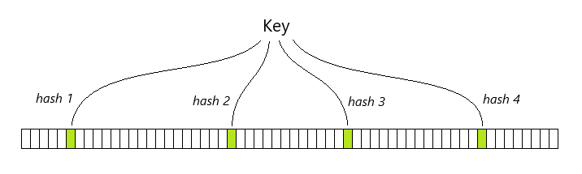
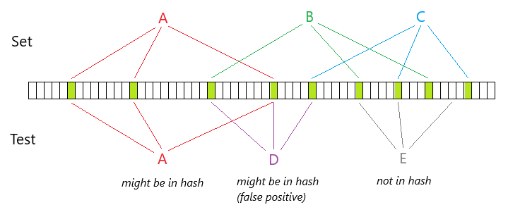
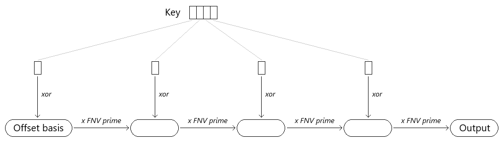
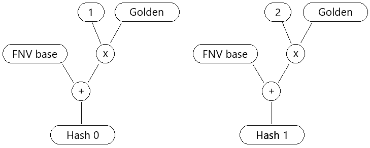
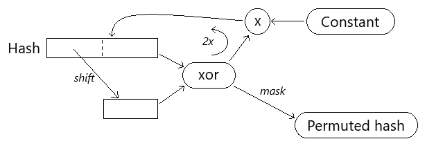
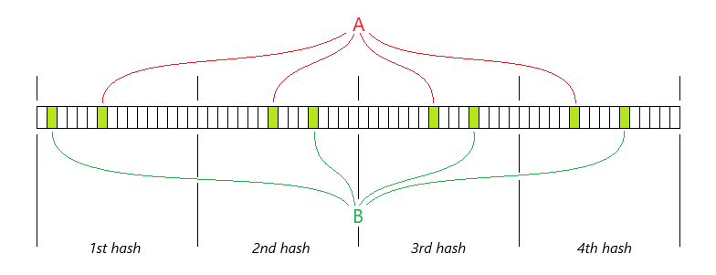
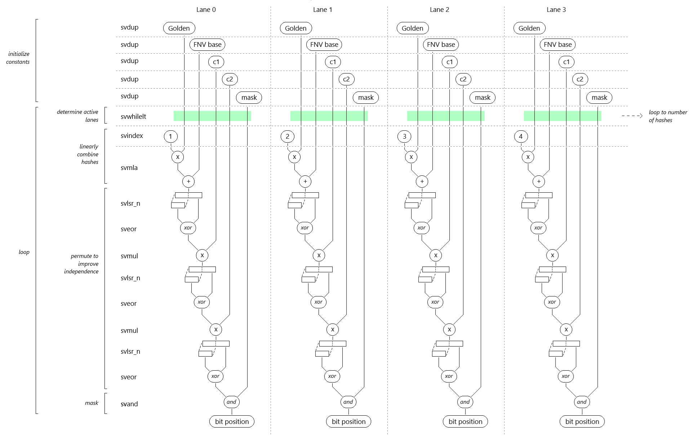
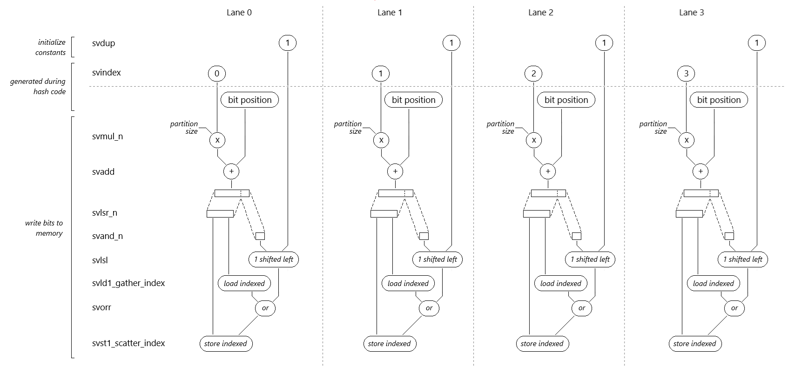
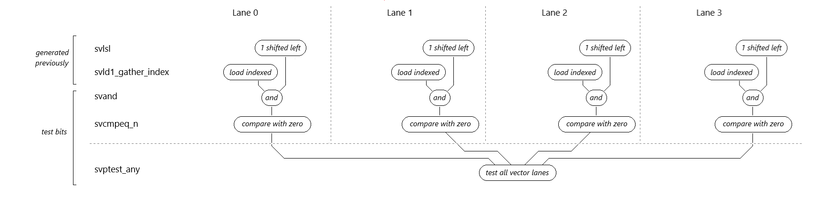

<!--
  SPDX-FileCopyrightText: Copyright 2026 Arm Limited and/or its affiliates <open-source-office@arm.com>
  SPDX-License-Identifier: BSD-3-Clause-Clear
-->

# Bloom filter

## Overview

A Bloom filter is a hashing algorithm that allows keys to be added to a hash buffer in a memory-efficient way. The Bloom filter can later determine whether a key might be present, versus whether it definitely is not present. It is not possible to determine that a key definitely is present, because the algorithm is susceptible to false positives by design, which is a tradeoff for speed and memory efficiency.

The Bloom filter is a large buffer of contiguous bits in memory. Whenever a key is added, the Bloom filter uses the key data to calculate a number of hash values. The number of hashes is specific to the filter. Each hash value will yield a bit index, and the bit in the filter at this location will then be set. For example, if a filter has four hash functions then whenever a key is added, four bit indices will be calculated and the corresponding four bits will be set in the filter buffer.



To determine whether a key is present, the Bloom filter must calculate all the hashes again, and test each of the bits indexed by those hash values. If any of the bits are zero, then the key has definitely not been added to the Bloom filter. However if all the tested bits are one, we can only conclude that the key might have been added. The reason is that if we add keys A, B and C to a Bloom filter, it is possible that between them they will set all of the bits corresponding to key D that has not been added, resulting in a false positive.



The rate of false positives for a given number of key insertions, can be controlled by careful selection of the size of the Bloom filter buffer, and the number of hash functions

It is not possible to delete elements from a standard Bloom filter, since setting bits to zero risks introducing false negatives for other keys that have previously been added. There are variants that support this at a cost of increased memory footprint, typically by replacing each bit with a counter showing how many times it has been set.

## Implementation details

The C++ interface is declared in `bloom.h`, with the hash functions and fused SVE operations implemented in `bloom.cpp`:

- `Filter` owns the bit array and provides the virtual `add` and `maybe_contains` interface, plus `clear` to reset the filter.
- `FilterWithHash<HashFn>` selects a hash function at compile time. That function returns a `BitPositions_t` array containing the bit positions for a key; the class then sets or tests those bits using scalar operations. Both the scalar variants and the unpartitioned SVE variants use this class.
- `BloomFilterSVE32Partitioned` and `BloomFilterSVE64Partitioned` derive directly from `Filter`. They fuse hash calculation with vector gather/scatter operations, keeping positions in SVE registers instead of returning a separate array of positions.

Each concrete filter can be constructed empty, or populated from a `const std::vector<std::string>&`. For example, `BloomFilterScalar64 filter(keys);` inserts the supplied keys during construction. The filter stores only the resulting bits; it does not retain the key strings.

Ideally the hash functions used in a Bloom filter should be fast and therefore typically non-cryptographic, have uniform distribution of output bit indices, and be independent of each other. This example implementation uses the FNV-1a (Fowler–Noll–Vo) algorithm. We initialise an accumulator with the offset basis which is a large prime seed, and for each character of the key to be added we xor the accumulator with the value of that character and multiply by the FNV prime.



We exploit the Kirsch-Mitzenmacher optimization where instead of calculating k different hash functions, it is sufficient to compute just two, and then calculate additional functions as a linear combination of the first two. In our implementation we use a constant named `golden` in place of the second FNV hash.



We then permute the result a number of times by alternately xoring it with itself shifted by an amount, and multiplying it by a constant. This makes the hash outputs appear more random, which improves their effective independence. Finally we apply a mask to select just the lower bits that map to the possible index values for the size of the Bloom filter.



The task uses deterministic pseudo-random strings of varying length, generated with the `build_keys` helper routine, in order to ensure repeatability and determinism in the tests and benchmarks.

## Opportunities for parallelism

Since the hash functions of a bloom filter are independent, they can be parallelized. Insertions of multiple keys are also independent of each other and could be parallelized, though this would only make sense if a large number of insertions will occur simultaneously.

Calculating multiple hash functions in parallel yields a list of bit indices. This list can be processed with a scalar loop that sets each indexed bit in turn, or alternatively the bits can all be set in parallel using vector operations. In the latter case, to eliminate conflicts it is common to partition the Bloom filter buffer so that each hash function writes to its own distinct region.



## Mapping the hash algorithm to SVE instrinsics

The hash algorithm is implemented in `bloom.cpp` in the functions `hashSVE32` and `hashSVE64`. It will be instructive to follow through the code as you read this section.

First we must initialise some constants. The `svdup` intrinsic duplicates a scalar value into every vector lane. We make use of this to initialise vector constants for Golden, FNV base, c1, c2, and the mask that will map the hash value to a bit index into the bloom filter buffer.

Next, we loop on the number of hashes, using `svwhilelt` to initialise a predicate, which is a vector of boolean values that each indicate whether the corresponding vector lane is active. The "LT" at the end of `svwhilelt` means "less than". It sets a lane to active if the loop counter for that lane is less than the terminating condition, which in this case is the total number of hashes. Most of the following instructions will use this predicate, to ensure they only operate on active vector lanes.

The graph below shows the execution flow for a configuration that has four vector lanes. A key observation is that each lane is independent of the others, meaning that it does not rely on data produced by another lane. Note that the intrinsics shown in the graph do not include the full intrinsic name. Typically there will be a `_u32` or `_u64` suffix to denote the data type, and optionally a `_z`, `_m`, or `_x` to denote whether the result for an inactive lane should be zeroed, preserved, or determined by the compiler. Please refer to the code for the full intrinsic names.



We use `svindex` to create a sequence of increasing integers commencing from the loop counter plus one. `svmla` multiplies the Golden vector by the index vector, adding the result to FNV base. This step linearly combines the FNV hash and Golden hash, and we now need to permute the result.

We extract the top bits using `svlsr_n`. The "LSR" means "Logical Shift Right". The "_n" means that the second operand is not a vector, but rather a scalar that applies to each vector lane. We now use `sveor` to exclusive-or the extracted bits with the original value. Finally we use `svmul` to multiply by the c1 vector.

We perform another round of permutation using the c2 vector in place of c1, and then another shift and exclusive-or. The hash values in each vector lane are suitably scrambled and should exhibit good independence from each other. The final step uses `svand` to extract the low bits that will index a position in the bloom filter buffer.

## Setting the bits in the bloom filter

By this point, we have a vector of bit indices into the bloom filter buffer. We can implement a scalar loop to set these one at a time (vector hash, scalar write), or we can use SVE to set them simultaneously using vector operations (vector hash, vector write). We avoid conflicts by partitioning the Bloom filter buffer so that each hash function writes to its own distinct region.

The partitioned code is in the function `BloomFilterSVENNPartitioned::add` where NN is 32 or 64 and denotes the data element size. The code to generate the bit positions is largely the same as covered previously, except:
1. the mask will now relate to the partition size instead of the Bloom filter size. The generated bit indices will therefore be indices into the partition, rather than indices into the filter.
2. for the writeback we will need to construct a sequence of increasing integers commencing from the loop counter. We have previously used a sequence commencing from the loop counter plus one. We avoid the need to have two separate sequences by adjusting the FNV base constant to be FNV base plus Golden. As a result, the hash code can now share a sequence that commences from the loop counter.

We multiply the sequence of integers by the partition size in order to get the base address of each partition. Because the partition size is a scalar operand, we use `svmul_n`. We then use `svadd` to add the bit position to the partition base address, to get the bit index within the whole filter.

We use `svlsr_n` to calculate the index of the word that we will need to write to, by shifting right by a constant. For 32-bit words we shift right by 5, and for 64-bit double words we shift right by 6.

To calculate the bit index within the target word, we extract the lower bits using `svand_n`. For 32-bit words we extract 5 bits using a mask of 31 (=0x1F), while for 64-bit double words we extract 6 bits using a mask of 63 (=0x3F).



Now that we have the index within the word, we need to construct a mask by left-shifting the value 1 by the index position. We use `svlsl` operating on a vector of ones that we initialise at the beginning of the function, and using the index position vector as the second operand.

We now have the index of each word that we need to write, and a mask that we can "or" into each value in order to set the required bit. We load the words using `svld1_gather_index`. The 32-bit version is `svld1_gather_u32index_u32` which loads a vector of 32-bit words from memory addresses indexed by a vector of 32-bit indices. The 64-bit version is `svld1_gather_u64index_u64` which loads a vector of 64-bit words from memory addresses indexed by a vector of 64-bit indices. It is called a "gather" load because it gathers values from separate memory addresses that could be far apart, and brings them together into adjacent vector lanes.

Once we have the words loaded into a vector, we use `svorr` to apply the mask, setting the required bit.

We store the updated values back using `svst1_scatter_index`. The 32-bit version is `svst1_scatter_u32index_u32` which stores a vector of 32-bit words to memory addresses indexed by a vector of 32-bit indices. The 64-bit version is `svst1_scatter_u64index_u64` which stores a vector of 64-bit words to memory addresses indexed by a vector of 64-bit indices. It is called a "scatter" store because it scatters values from adjacent vector lanes into separate memory addresses that could be far apart.

Finally, we need to increment the loop counter by the number of lanes we have processed. `svcntw` returns the number of 32-bit lanes, whilst `svcntd` returns the number of 64-bit lanes.

## Testing whether bits are set in a bloom filter

To test if a key is already present in the Bloom filter, we execute the preceding code up until the `svld1_gather_index`. Then, instead of a bitwise "or" to set the required bit, we use `svand` to extract it. We use `svcmpeq_n` to compare the vector of extracted bits with zero. Because zero is a scalar we use the `_n` form of this intrinsic. `svcmpeq_n` tests each value in the vector, and returns a predicate that indicates for each active lane whether it met the equality condition, with each inactive lane set to false.



If any of the bits are zero then we can be certain that the key is not in the Bloom filter. Otherwise, we have to keep looking. If a vector lane contains zero then the `svcmpeq_n` predicate will be true for that lane. So if any lane in the `svcmpeq_n` predicate is true then we can stop, and return that the key was not in the Bloom filter.

The `svptest_any` intrinsic tests every lane in the predicate, and returns true if any of the individual lanes are true.

## Bloom filter variants

This package contains eight Bloom-filter variants for demonstrating incremental use of Arm SVE:

0. `64-bit scalar` - scalar hash calculation using 64-bit data element size and scalar bit setting/testing, using an ordinary unpartitioned Bloom bit space.
1. `32-bit scalar` - scalar hash calculation using 32-bit data element size and scalar bit setting/testing, using an ordinary unpartitioned Bloom bit space.
2. `64-bit scalar partitioned` - SVE intrinsic hash calculation using 64-bit data element size and scalar bit setting/testing, using an ordinary unpartitioned Bloom bit space.
3. `32-bit scalar partitioned` - scalar hash calculation using 32-bit data element size and scalar bit setting/testing, using an ordinary unpartitioned Bloom bit space.
4. `64-bit SVE` - SVE intrinsic hash calculation using 64-bit data element size, followed by scalar bit setting/testing, also using the ordinary unpartitioned Bloom bit space.
5. `32-bit SVE` - SVE intrinsic hash calculation using 32-bit data element size, followed by scalar bit setting/testing, also using the ordinary unpartitioned Bloom bit space.
6. `64-bit SVE partitioned` - SVE intrinsic hash calculation using 64-bit data element size plus SVE vector gather read / scatter write bit setting and testing. Each hash owns a separate consecutive slice of the Bloom bit space.
7. `32-bit SVE partitioned` - SVE intrinsic hash calculation using 32-bit data element size plus SVE vector gather read / scatter write bit setting and testing. Each hash owns a separate consecutive slice of the Bloom bit space.

The "SVE" variants show the benefit of parallelising only the hash generation. The "SVE partitioned" variants show the further change required to set and test bits using vector operations. The partitioned layout avoids collisions between different hash functions within a single vector update, which makes vector gather read / scatter write bit operations safe for this example.

## Performance considerations

The performance of SVE is closely tied to the number of vector lanes available. An SVE operation targeting a vector of 32-bit data will utilise twice as many vector lanes as the corresponding SVE operation targeting a vector of 64-bit data. As a result, the 32-bit operation will achieve significantly higher throughput than the 64-bit operation.

When comparing SVE performance against the scalar implementation, it is important to be aware that modern compilers do an excellent job optimising the scalar code. Because the number of hashes is a compile-time constant, the compiler can efficiently unroll the scalar loop many times. It can interleave these independent loops, gaining tremendous freedom to reorder instructions and absorb result delays. An SVE 64-bit variant running on a machine with Scalable Vector Length = 128 bits would only have two vector lanes available, which limits performance. Moving to four vector lanes, for example by using a 32-bit variant, should demonstrate considerably better performance.

The 64-bit variants are more affected by memory system constraints, since they have twice the size of data to move compared to the 32-bit variants. This is particularly noticeable for gather loads and scatter writes, which attempt many memory accesses concurrently. A configuration with eight vector lanes attempting a gather load can in theory trigger eight cache lines to be fetched from different addresses in memory before the operation can be completed.

## Configuration

`bloom_config.h` defines key properties of the bloom filter:

- `BLOOM_BITS`             - the size, in bits, of the Bloom filter in memory
- `BLOOM_NUM_HASHES`       - the number of hashes to generate for each key
- `BLOOM_NUM_PRECALC_KEYS` - the available number of pre-calculated keys (used in testing and benchmarking)
- `BLOOM_MAX_KEY_LENGTH`   - the maximum string length randomly generated for each key

Defaults:

```c
#define BLOOM_BITS                  (1 << 23)
#define BLOOM_NUM_HASHES            64
#define BLOOM_NUM_PRECALC_KEYS      50000
#define BLOOM_MAX_KEY_LENGTH        96
```

`BLOOM_BITS` and `BLOOM_NUM_HASHES` must each be a power of two, so that the hash partition size is also a power of two, simplifying the code.

You can override bloom filter size, hash count, key pool size or maximum key length (note that overriding defines will cause `cmake` to remember the new values in future invocations):

```sh
cmake -DBLOOM_BITS="(1 << 21)" -DBLOOM_NUM_HASHES=32 -DBLOOM_NUM_PRECALC_KEYS=80000 -DBLOOM_MAX_KEY_LENGTH=64 -G "Ninja Multi-Config" -S . -B build
```

## Building and running

These steps assume you have already [installed the software requirements](../../docs/building.md#software-requirements) and [configured the project](../../docs/building.md#configuring-and-building). Run the commands from the repository root, starting with (refer to the previous section for tuning some of the bloom filter parameters):

```sh
cmake -G "Ninja Multi-Config" -S . -B build
```

Build the bloom filter:

```sh
cmake --build build --config Release --target bloom_filter
```

The `bloom_filter` executable operates in 2 modes:
- With no argument, `bloom_filter` will print out its configuration parameters and enumerate the available bloom filter variants,
- With arguments, the first argument is the bloom filter variant number to use and all other remaining arguments are strings used as keys to insert into the filter. `bloom_filter` will first query if the filter contains the key and then add it if it does not exist in the filter.

First, run the executable with no argument to have a list of available bloom filter variants:

```sh
./build/bloom_filter/Release/bloom_filter
```

```sh
Bloom bits: 8388608
Bloom hashes k: 64 fixed hashes
Partitioned slice bits per hash: 131072
Number of pre-calculated keys: 50000
Maximum length of each key: 96
Scalable Vector Length: 128 bits
Number of 64-bit SVE lanes: 2
Number of 32-bit SVE lanes: 4

Available Bloom filter variants:
  0: 64-bit scalar
  1: 32-bit scalar
  2: 64-bit scalar partitioned
  3: 32-bit scalar partitioned
  4: 64-bit SVE
  5: 32-bit SVE
  6: 64-bit SVE partitioned
  7: 32-bit SVE partitioned

Usage: ./build/bloom_filter/Release/bloom_filter <variant> [key ...]
```

Then pick a variant to test and insert keys into the filter with:
```sh
./build/bloom_filter/Release/bloom_filter 4 "one" "two" "three" "four" "two"
```

```sh
Bloom filter variant 4: 64-bit SVE
Inserting 5 keys:
 - "one": absent, inserted
 - "two": absent, inserted
 - "three": absent, inserted
 - "four": absent, inserted
 - "two": possibly present, insertion skipped
```

## Testing

Run the validation tests:

```sh
cmake --build build --config Release -t test-bloom_filter
```

The tests in `test.cpp` are shared amongst the different variants and are checking insertion, lookup, clearing, as well as constructors of the filters. There are also checks for the scalar vs SVE implementations, to compare that the hash functions provide the same results, or that the bit array are the same. These can be seen as checking the SVE implementations against known good references.

The harness checks each variant against the relevant scalar reference:

- `scalar` and `SVE` must match the unpartitioned scalar bitmap.
- `SVE partitioned` must match the partitioned scalar bitmap.
- `64-bit` variants must match a `64-bit` scalar bitmap, while `32-bit` variants must match a `32-bit` scalar bitmap.

The partitioned variants are not expected to produce the same bitmap as the unpartitioned variants since they intentionally use a different bit layout. The 64-bit variants are not expected to produce the same bitmap as the 32-bit variants since their hash functions differ.

## Benchmarking

For each available bloom filter variant, the benchmark measures the throughput (in keys per second) of:
- key insertions,
- existing key lookups,
- non-existing key lookups

Run the benchmarks:

```sh
cmake --build build --config Release -t benchmark-bloom_filter
```

```sh
...
-------------------------------------------------------------------------------------------------------------------------------
Benchmark                                                                     Time             CPU   Iterations UserCounters...
-------------------------------------------------------------------------------------------------------------------------------
bloom_filter_insert_key<BloomFilterScalar64>                                172 ns          172 ns      4065238 items_per_second=5.8043M/s
bloom_filter_insert_key<BloomFilterScalar32>                                142 ns          142 ns      4923834 items_per_second=7.03324M/s
bloom_filter_insert_key<BloomFilterScalar64Partitioned>                     173 ns          173 ns      4049176 items_per_second=5.78894M/s
bloom_filter_insert_key<BloomFilterScalar32Partitioned>                     145 ns          145 ns      4808845 items_per_second=6.87308M/s
bloom_filter_insert_key<BloomFilterSVE64>                                   197 ns          197 ns      3543205 items_per_second=5.06438M/s
bloom_filter_insert_key<BloomFilterSVE32>                                   151 ns          151 ns      4654851 items_per_second=6.63668M/s
bloom_filter_insert_key<BloomFilterSVE64Partitioned>                        230 ns          230 ns      3050059 items_per_second=4.35535M/s
bloom_filter_insert_key<BloomFilterSVE32Partitioned>                        149 ns          149 ns      4705534 items_per_second=6.71465M/s
bloom_filter_lookup_existing_key<BloomFilterScalar64>                       165 ns          165 ns      4252366 items_per_second=6.0773M/s
bloom_filter_lookup_existing_key<BloomFilterScalar32>                       135 ns          135 ns      5161758 items_per_second=7.40867M/s
bloom_filter_lookup_existing_key<BloomFilterScalar64Partitioned>            165 ns          165 ns      4236876 items_per_second=6.05616M/s
bloom_filter_lookup_existing_key<BloomFilterScalar32Partitioned>            139 ns          139 ns      5022385 items_per_second=7.1886M/s
bloom_filter_lookup_existing_key<BloomFilterSVE64>                          185 ns          185 ns      3785955 items_per_second=5.40812M/s
bloom_filter_lookup_existing_key<BloomFilterSVE32>                          142 ns          142 ns      4943735 items_per_second=7.0614M/s
bloom_filter_lookup_existing_key<BloomFilterSVE64Partitioned>               217 ns          217 ns      3226343 items_per_second=4.5996M/s
bloom_filter_lookup_existing_key<BloomFilterSVE32Partitioned>               129 ns          129 ns      5411967 items_per_second=7.73447M/s
bloom_filter_lookup_non_existing_key<BloomFilterScalar64>                   106 ns          106 ns      6640953 items_per_second=9.47476M/s
bloom_filter_lookup_non_existing_key<BloomFilterScalar32>                  76.3 ns         76.3 ns      9209206 items_per_second=13.101M/s
bloom_filter_lookup_non_existing_key<BloomFilterScalar64Partitioned>        108 ns          108 ns      6474759 items_per_second=9.24862M/s
bloom_filter_lookup_non_existing_key<BloomFilterScalar32Partitioned>       81.2 ns         81.2 ns      8626518 items_per_second=12.3226M/s
bloom_filter_lookup_non_existing_key<BloomFilterSVE64>                      127 ns          127 ns      5481372 items_per_second=7.85516M/s
bloom_filter_lookup_non_existing_key<BloomFilterSVE32>                     83.4 ns         83.4 ns      8366375 items_per_second=11.9863M/s
bloom_filter_lookup_non_existing_key<BloomFilterSVE64Partitioned>          45.7 ns         45.7 ns     15325134 items_per_second=21.8986M/s
bloom_filter_lookup_non_existing_key<BloomFilterSVE32Partitioned>          40.6 ns         40.6 ns     17235070 items_per_second=24.622M/s
```
